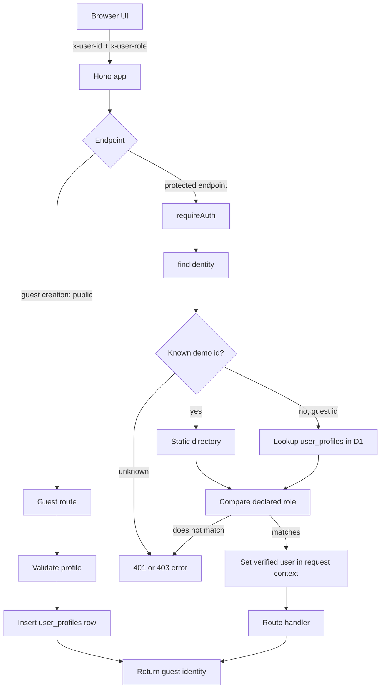

# Backend Core: identity, authentication และ HTTP helpers

บทนี้อธิบายการยืนยันตัวตนแบบ stub ที่มีอยู่จริงในระบบ: client ส่ง identity headers, backend ตรวจ header กับ static directory หรือ guest profile ใน D1 แล้วแนบ user ที่ตรวจแล้วลง Hono context ให้ handler ถัดไปอ่านได้

> ข้อสำคัญ: identity stub นี้ไม่ได้พิสูจน์ว่าผู้ส่ง request เป็นบุคคลที่กล่าวอ้าง ไม่ใช่ password login, SSO หรือ token-based authentication

## 1. ภาพรวมไฟล์และหน้าที่

| ไฟล์ | หน้าที่ | ความสัมพันธ์ |
|---|---|---|
| [`backend/src/core/env.ts`](../../../../backend/src/core/env.ts:1) | ประกาศ Worker bindings, request variables และ Hono environment type | ใช้เป็น generic type ของ middleware/routes |
| [`backend/src/core/identity.ts`](../../../../backend/src/core/identity.ts:26) | กำหนด role, identity shape, demo directory และ guest ID range | `profiles.ts`, auth middleware, route handlers |
| [`backend/src/core/profiles.ts`](../../../../backend/src/core/profiles.ts:11) | validate guest profile, lookup identity, อ่าน display names และ CRUD profile | ใช้โดย `auth.ts`, auth routes และส่วนอื่นที่ต้องแปลง id เป็นชื่อ |
| [`backend/src/core/auth.ts`](../../../../backend/src/core/auth.ts:19) | ตรวจ `x-user-id`/`x-user-role` และจำกัด role | ติดตั้งจาก Worker entry point ก่อน route handlers |
| [`backend/src/core/http.ts`](../../../../backend/src/core/http.ts:12) | error classes/helpers, JSON reader, id parser, correlation ID และ global error handler | ใช้ร่วมกันทุก route และติดตั้งจาก entry point |
| [`backend/src/core/config.ts`](../../../../backend/src/core/config.ts:12) | ตรวจค่า URL สาธารณะของหน้า Maintenance | ใช้โดย reference endpoint |
| [`backend/src/modules/auth/routes.ts`](../../../../backend/src/modules/auth/routes.ts:18) | routes สำหรับสร้าง guest, ตรวจ `/me`, แก้ profile guest | ใช้ validation/DB helpers จาก core |
| [`backend/src/modules/reference/routes.ts`](../../../../backend/src/modules/reference/routes.ts:26) | public directory/settings/health/reference endpoints | `/users` ให้ frontend อ่าน static demo accounts ได้ |
| [`backend/src/index.ts`](../../../../backend/src/index.ts:29) | ประกอบ middleware และ mounts routers | ระบุว่า endpoints ใดถูกป้องกันด้วย auth/role middleware |

## 2. ภาพ request/authentication flow

**Mounting สำคัญ:** ใน [`backend/src/index.ts`](../../../../backend/src/index.ts:42) `/tickets` และ path ลูกถูกครอบด้วย `requireAuth`; `/me` ถูกครอบด้วย `requireAuth`; `/admin/*` ต้องผ่านทั้ง `requireAuth` และ `requireRole('admin')`. Auth routes ถูก mount แยก และ `POST /auth/guest` จงใจเป็น public เพื่อให้ผู้ใช้ขอ guest id ได้ก่อนมี session. Reference routes รวมถึง `/users` ก็ public ตาม implementation และ comment ใน [`backend/src/modules/reference/routes.ts`](../../../../backend/src/modules/reference/routes.ts:1)

## 3. Shared Worker types

ใน [`backend/src/core/env.ts`](../../../../backend/src/core/env.ts:8) `Bindings` ประกาศ object ที่ Cloudflare ส่งให้ request เช่น `DB`, optional Workers AI binding, environment variables และ optional secrets สำหรับ integrations. เนื้อหาไฟล์กำหนดชื่อ/type เท่านั้น ไม่ได้เปิดเผยค่าจริงของ secret.

- `AuthUser` คือข้อมูลผู้ใช้หลัง auth: `id`, `role`, `displayName`.
- `Variables` ระบุค่าที่เก็บใน Hono context ต่อ request ได้แก่ `user` และ `correlationId`.
- `AppEnv = { Bindings, Variables }` ถูกใช้เป็น generic เช่น `Hono<AppEnv>` และ `MiddlewareHandler<AppEnv>` เพื่อให้ `c.env` และ `c.get('user')` มี type.

แนวคิด: `Bindings` เป็น dependency/config ที่ runtime ผูกให้ Worker; `Variables` เป็น request-scoped state ที่ middleware ใส่ให้ handler ภายใน request เดียวกัน

## 4. Identity model แบบ stub

### 4.1 Role และรูปข้อมูล

[`Role`](../../../../backend/src/core/identity.ts:31) เป็น union ของ `'customer' | 'admin'`. [`IdentityRef`](../../../../backend/src/core/identity.ts:33) มี `externalId`, `displayName`, `role`, `email`; ชื่อ field ทำให้ downstream ไม่ต้องรู้ว่า record มาจาก static map หรือ guest table.

### 4.2 Static demo directory

[`USER_DIRECTORY`](../../../../backend/src/core/identity.ts:49) เป็น `Record<number, IdentityRef>` สำหรับ id `1`, `2`, `5`, `6`; id 1, 2, 6 เป็น customer และ id 5 เป็น admin. ใน production ตาม comment ใน source directory ควรมาจาก Campus Identity/SSO ไม่ใช่ map นี้

[`verify(externalId)`](../../../../backend/src/core/identity.ts:62) คืน `null` ถ้า id ไม่ใช่ positive integer; ถ้า valid จะคืน entry จาก map หรือ `null` เมื่อไม่รู้จัก. [`GUEST_ID_MIN`](../../../../backend/src/core/identity.ts:68) กำหนดค่าเริ่มต้นช่วง guest ที่ 1000; [`isGuestId(id)`](../../../../backend/src/core/identity.ts:69) ตรวจว่าเป็น integer และไม่น้อยกว่า 1000. [`isAdmin(role)`](../../../../backend/src/core/identity.ts:72) เป็น helper เปรียบเทียบ role กับ `'admin'`.

## 5. Guest profiles และ identity lookup

### 5.1 Validation

[`validateProfile(input)`](../../../../backend/src/core/profiles.ts:18) เป็น pure validation: รับ `name`/`email` เป็น `unknown`, trim เฉพาะค่าที่เป็น string และสร้าง `errors` ตาม field.

- ชื่อต้องยาว 2–60 ตัวอักษรหลัง trim.
- email ไม่บังคับ; ถ้ามี ต้องยาวไม่เกิน 120 และผ่าน regex รูปแบบพื้นฐาน `local@domain.tld`.
- ค่าว่างของ email ถูก normalize เป็น `null`.
- คืน discriminated union: `{ ok: false, errors }` หรือ `{ ok: true, value: { name, email } }`.

การตรวจรูปแบบนี้ไม่ได้ส่งอีเมลหรือยืนยันว่าที่อยู่นั้นเป็นของผู้ใช้

### 5.2 Lookup identity

[`findIdentity(db, id)`](../../../../backend/src/core/profiles.ts:34) ใช้ลำดับ:

1. เรียก `verify(id)` ก่อน; ถ้าเป็น static user คืนได้ทันทีโดยไม่ query DB.
2. ถ้า id ไม่ใช่ guest ID คืน `null`.
3. ถ้าเป็น guest id query `user_profiles` ด้วย prepared statement และ bind ค่า id.
4. ถ้าพบ row สร้าง `IdentityRef` โดยกำหนด role เป็น `customer`; email null ถูก normalize เป็น string ว่าง.

### 5.3 แปลง IDs เป็นชื่อ

[`displayNames(db, ids)`](../../../../backend/src/core/profiles.ts:43) สร้าง `Map<number, string>` สำหรับรายการชื่อที่ใช้แสดง:

- ใช้ `Set(ids)` เพื่อลด id ซ้ำ และข้าม `null`/`undefined`.
- Static users อ่านชื่อจาก directory ใน memory.
- Guest ids สะสมไว้ query `user_profiles`.
- guest ids ถูกแบ่งเป็น chunks ละ 50 ก่อนสร้าง `IN (?, ?, ...)`; bind variables ถูกส่งแยกด้วย `.bind(...chunk)`.
- คืน map; id ที่ unknown หรือไม่มี profile จะไม่มี entry.

การแบ่ง batch ป้องกัน query เดียวใช้ bind parameters มากเกินขีดจำกัดที่โค้ดตั้งใจรองรับใน SQLite/D1

### 5.4 สร้างและแก้ guest

[`createGuest(db, value)`](../../../../backend/src/core/profiles.ts:65) ใช้ `INSERT ... RETURNING`: subquery คำนวณ `COALESCE(MAX(id), GUEST_ID_MIN - 1) + 1` จาก `user_profiles`, จากนั้น insert ชื่อและ email ที่ bind มา และคืน row ใหม่. `row!` เป็น non-null assertion; implementation คาดว่า D1 `RETURNING` คืน row สำเร็จ.

[`updateGuest(db, id, value)`](../../../../backend/src/core/profiles.ts:78) update `full_name`, `email`, `updated_at` โดย `WHERE id = ?`, แล้วใช้ `RETURNING`; ถ้าไม่มี row ตรงกันจะได้ `null`.

Schema ที่ยืนยันว่ามี `user_profiles` และ columns เหล่านี้อยู่ใน [`database/schema.sql`](../../../../database/schema.sql:105); migration และการทำงานของ D1 จะอธิบายเต็มในบท database

## 6. Authentication และ role middleware

### 6.1 `requireAuth`

[`requireAuth`](../../../../backend/src/core/auth.ts:19) ทำงานก่อน protected handler:

1. อ่าน `x-user-id` และ `x-user-role` จาก request headers.
2. ถ้าขาด header ใด header หนึ่ง โยน `ApiError` status 401.
3. ตรวจว่า declared role เป็นหนึ่งใน `customer`/`admin`; ค่าอื่นได้ 403.
4. แปลง id ด้วย `Number(userId)` แล้วเรียก `findIdentity(c.env.DB, id)`.
5. ถ้าไม่พบ identity ได้ 401.
6. ถ้า role ที่ client อ้างไม่ตรง role จาก directory/profile ได้ 403.
7. ถ้าตรงกัน ใส่ `{ id, role, displayName }` ที่มาจาก identity lookup ลง context ด้วย `c.set('user', ...)`.
8. เรียก `await next()` ให้ middleware/route handler ถัดไปทำงาน.

handler ควรใช้ `c.get('user')` หลัง middleware แทนอ่าน header ซ้ำ เพราะ context user ผ่านการตรวจ id และ role แล้ว

### 6.2 `requireRole`

[`requireRole(...roles)`](../../../../backend/src/core/auth.ts:41) คืน middleware ที่อ่าน `c.get('user').role`; ถ้า role ไม่อยู่ใน allowlist จะ throw 403, มิฉะนั้น `await next()`. มันไม่อ่าน header และไม่ได้ lookup identity เอง จึงต้องวางหลัง `requireAuth` ใน route ที่ใช้

### 6.3 ขอบเขตความปลอดภัย

ระบบป้องกัน role ที่ปลอมไม่ตรงกับ identity record แต่ตัว header เองเป็น input จาก browser และไม่มี credential/signature แนบมาพิสูจน์ผู้ใช้ได้. ตัว identity `id=5, role=admin` เป็น demo account ที่เห็นใน frontend source/config; วิธีนี้ไม่ควรถือเป็น authentication ที่ปลอดภัยสำหรับ production. Source เองระบุว่าเป็น stub และต้องแทนที่ด้วย Campus Identity/SSO ใน [`backend/src/core/identity.ts`](../../../../backend/src/core/identity.ts:13)

## 7. Auth routes ที่เชื่อม frontend กับ core

ใน [`backend/src/modules/auth/routes.ts`](../../../../backend/src/modules/auth/routes.ts:18) มี `authRoutes` และ helper `shape(profile)` ซึ่งคืน `id`, `full_name`, role คงที่เป็น customer, และ email ที่เปลี่ยน null เป็น `''`.

### `POST /auth/guest`

[`authRoutes.post('/auth/guest', ...)`](../../../../backend/src/modules/auth/routes.ts:27):

1. ใช้ `readJson()` อ่าน `{ name?, email? }`.
2. ส่ง body ไป `validateProfile()`.
3. validation fail → `ApiError(422, 'ValidationError', ..., { fields: errors })`.
4. success → `createGuest(c.env.DB, parsed.value)`.
5. คืน status 201 พร้อม `{ message: 'Guest created', data: shape(created) }`.

route นี้ public ตามการ mount ที่ entry point เพราะ requester ยังไม่มี id ก่อนสร้าง profile.

### `GET /me`

[`authRoutes.get('/me', ...)`](../../../../backend/src/modules/auth/routes.ts:34) อ่าน user ที่ `requireAuth` ใส่ไว้ใน context, lookup ซ้ำด้วย `findIdentity` เพื่อได้ display/email ปัจจุบัน, คืน 404 ถ้าไม่มีแล้ว และสำเร็จด้วย `{ data: { id, full_name, role, email } }`. ใน entry point path `/me` ถูกป้องกันด้วย auth middleware

### `PUT /me`

[`authRoutes.put('/me', ...)`](../../../../backend/src/modules/auth/routes.ts:41):

1. อ่าน verified user จาก context.
2. ถ้า `!isGuestId(user.id)` ปฏิเสธด้วย 400 (`Demo accounts cannot be edited`).
3. อ่าน JSON และ validate เหมือน create guest; invalid ได้ 422 พร้อม field errors.
4. เรียก `updateGuest`; ถ้าไม่พบ row ได้ 404.
5. คืน profile ผ่าน `shape()`.

## 8. HTTP helpers และ error path

### `ApiError` และ factory functions

[`ApiError`](../../../../backend/src/core/http.ts:12) เก็บ HTTP status, machine-readable `code`, message และ `extra`. Helper [`badRequest`](../../../../backend/src/core/http.ts:23), `forbidden`, `notFound`, `conflict` และ [`notImplemented`](../../../../backend/src/core/http.ts:33) สร้าง error ที่มี code/status สอดคล้องกัน. ตัวอย่าง 501 เพิ่ม `feature` และ `owner` ใน `extra` เพื่อให้ UI บอก feature ที่ยังไม่พร้อมได้

### อ่าน JSON และ parse path ID

- [`readJson<T>(c)`](../../../../backend/src/core/http.ts:40) เรียก `c.req.json()`; parse fail กลายเป็น 400 `Request body must be valid JSON`. Generic `T` บอก type ที่ caller คาด แต่ไม่ได้ validate runtime shape.
- [`parseId(raw, name)`](../../../../backend/src/core/http.ts:50) แปลงด้วย `Number`; รับเฉพาะ positive integer. ค่าว่าง, `0`, ทศนิยม, ค่าติดลบ และ `NaN` ถูกปฏิเสธด้วย 400.

### Correlation ID และ error response กลาง

- [`correlationId`](../../../../backend/src/core/http.ts:58) ใช้ `x-correlation-id` ที่ caller ส่งมา หรือสร้าง `team14-${crypto.randomUUID()}`; เก็บใน context และ echo response header `X-Correlation-Id` ก่อน `next()`.
- [`handleError(err, c)`](../../../../backend/src/core/http.ts:66) แยก `ApiError` (คืน status/code/message/extra), Hono `HTTPException` (คืน `HttpError`) และ error ทั่วไป.
- error ทั่วไปจะถูก log เป็น JSON ที่มี correlation id และ `String(err)`; response client เป็น generic 500 โดยไม่ส่ง stack trace.
- `index.ts` ติดตั้ง `app.onError(handleError)` และ correlation middleware ก่อน route ตามลำดับที่เห็นใน source.

## 9. Public reference config ที่เกี่ยวกับ core

[`portalUrl(raw)`](../../../../backend/src/core/config.ts:12) trim ค่าที่อาจเป็น undefined, รับเฉพาะ string ที่ตรงกับ `http://`/`https://` และไม่มี whitespace; กรณีไม่ผ่านคืน `null`. [`GET /config`](../../../../backend/src/modules/reference/routes.ts:36) ส่งค่า validate แล้วเป็น `maintenance_portal_url`; ไม่ส่ง secrets.

`GET /users` ใน [`backend/src/modules/reference/routes.ts`](../../../../backend/src/modules/reference/routes.ts:26) map `USER_DIRECTORY` เป็นข้อมูล public `{ id, full_name, role, email }`. Frontend ใช้ endpoint นี้สำหรับ `?as=<demo-id>` เพื่อหา role ของ static demo user.

## 10. ตัวอย่าง end-to-end: guest สร้าง profile แล้วเรียก `/me`

Input จาก browser: `{ name: '  Mali  ', email: ' mali@example.test ' }`.

1. Client ส่ง `POST /api/v1/auth/guest` โดยยังไม่มี `currentUser` จึงไม่มี identity headers ที่ต้องใช้ auth.
2. Route อ่าน JSON; `validateProfile` trim ค่าเป็น `name = 'Mali'`, `email = 'mali@example.test'`.
3. `createGuest` insert row ใน `user_profiles`; หากตารางยังไม่มี guest, formula ใช้ `COALESCE(MAX(id), 999) + 1` จึงเสนอ id `1000`.
4. Route คืน HTTP 201, `{ message: 'Guest created', data: { id: 1000, full_name: 'Mali', role: 'customer', email: 'mali@example.test' } }`.
5. Frontend จำ id/role แล้ว request `GET /api/v1/me` พร้อม `x-user-id: 1000`, `x-user-role: customer`.
6. `requireAuth` แปลง id เป็น number และ `findIdentity` หา id ไม่เจอใน static directory; เนื่องจากเป็น guest id จึง query `user_profiles`.
7. `requireAuth` เทียบ role จาก row (`customer`) กับ header; ตรงกันจึง set context user และเรียก `next()`.
8. `/me` handler lookup identity อีกครั้ง แล้วคืน `{ data: { id: 1000, full_name: 'Mali', role: 'customer', email: 'mali@example.test' } }`.

ตัวอย่างนี้จำลองผลตาม source และ schema ที่อ่านแล้ว; ไม่ได้รัน against D1 จริง และไม่ใช่การยืนยันตัวบุคคล

## 11. Tests, จุดพลาดที่พบบ่อย และผลกระทบจากการแก้

### Tests ที่ตรวจ source แล้ว

- [`backend/test/comments.test.ts`](../../../../backend/test/comments.test.ts:49) มีชุด guest profile tests: ชื่อ 2–60, email optional/basic format, guest ID เริ่ม 1000 และไม่อยู่ใน static `verify()`.
- [`backend/test/config.test.ts`](../../../../backend/test/config.test.ts:4) ตรวจ `portalUrl`: รับ http(s), trim, รองรับ `{ticketRef}`, ปฏิเสธ empty/undefined/non-http/space.
- ใน `backend/test/` ที่ค้นหาไม่พบ unit tests โดยตรงสำหรับ `requireAuth`, auth route status/body, `findIdentity` database lookup, หรือ `displayNames` chunking. นี่เป็นเพียงผลจาก test inventory ปัจจุบัน ไม่ได้หมายความว่า behavior ไม่ถูกทดสอบด้วยวิธีอื่นนอก directory นี้.

### สิ่งที่ควรระวัง

1. **Guest profile ไม่ใช่ account:** ผู้ใช้ที่รู้/เดา guest id และส่ง role ที่ถูกต้องอาจอ้าง identity ได้; ไม่ควรใช้ stub นี้แทน SSO.
2. **อย่าใช้ declared header role เป็น authority:** `requireAuth` เทียบกับ role จาก static directory/profile ก่อน set context; handler ควรใช้ context user.
3. **Public guest creation:** `POST /auth/guest` ไม่ต้อง auth โดยออกแบบ; เปลี่ยน guard โดยไม่ปรับ client จะทำให้คนใหม่เริ่ม session ไม่ได้.
4. **Validation generic ไม่ใช่ runtime schema:** `readJson<T>` cast type เท่านั้น; validation ของ name/email เป็นหน้าที่ `validateProfile`, ส่วน request handlers อื่นต้อง validate ของตัวเอง.
5. **API errors มี shape ที่ frontend พึ่งพา:** status, `error`, `message`, `fields` ใช้สร้าง `ApiError`; เปลี่ยน `extra.fields` หรือ error handler ต้องตรวจ client ให้สอดคล้อง.
6. **Guest ID range เป็น contract ข้าม frontend/backend/DB:** เปลี่ยน `GUEST_ID_MIN` ที่ฝั่งเดียวทำให้ id ถูกจัดประเภทผิด.
7. **Unknown users:** static id ต้องอยู่ใน directory; guest id ต้องมี row; มิฉะนั้น `/me` และ protected requests fail.
8. **`requireRole` ขึ้นกับลำดับ middleware:** ถ้าเรียกก่อน auth จะอ่าน context user ที่ยังไม่ set.

## 12. ยังไม่ครอบคลุม

บทนี้ยังไม่อธิบาย ticket authorization rules, route handlers อื่น, migration SQL ทั้งหมด, production SSO, integration secrets หรือ runtime deployment behavior. รายการ source ที่ยังไม่วิเคราะห์อัปเดตไว้ใน [`DOCUMENTATION_PROGRESS.md`](../../DOCUMENTATION_PROGRESS.md)
