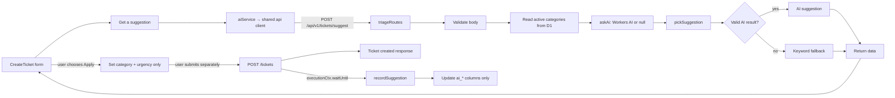

# AI Triage: คำแนะนำหมวดหมู่ ความเร่งด่วน และเส้นทางส่งต่อ

โมดูลนี้ทำ triage แบบช่วยแนะนำ ไม่ใช่การตัดสินใจแทนผู้ใช้หรือการเปลี่ยนข้อมูล ticket โดยอัตโนมัติ มี 2 จุดที่เรียกคำแนะนำได้: ผู้แจ้งขอ suggestion ก่อนส่งฟอร์ม และระบบคำนวณ suggestion อีกครั้งหลังสร้าง ticket เพื่อบันทึกค่าประกอบสำหรับงานต่อไป

## 1. ขอบเขตและไฟล์

| ไฟล์ | หน้าที่ | ความสัมพันธ์ |
|---|---|---|
| [`backend/src/ai/routes.ts`](../../../../backend/src/ai/routes.ts:20) | `POST /tickets/suggest`, validate input, โหลด active categories และคืน suggestion | mount จาก [`backend/src/index.ts`](../../../../backend/src/index.ts:24); เรียก `askAi` และ `pickSuggestion` |
| [`backend/src/ai/ai.ts`](../../../../backend/src/ai/ai.ts:14) | สร้าง prompt, เรียก Workers AI, timeout และ parse response | ใช้ optional `AI` binding จาก Worker env |
| [`backend/src/ai/fallback.ts`](../../../../backend/src/ai/fallback.ts:7) | กำหนด types/allowed values, keyword fallback และตรวจ AI output | logic deterministic ที่ปลายทางใช้เมื่อ AI ว่าง/ใช้ไม่ได้ |
| [`backend/src/ai/pickSuggestion.ts`](../../../../backend/src/ai/pickSuggestion.ts:12) | เลือก output จาก AI ที่ valid หรือใช้ fallback | ใช้ทั้ง route และ background recording |
| [`backend/src/ai/record.ts`](../../../../backend/src/ai/record.ts:9) | คำนวณ suggestion หลังสร้าง ticket และเขียนเฉพาะ `ai_*` columns | เรียกจาก ticket creation ด้วย `waitUntil` |
| [`backend/src/ai/askAi.ts`](../../../../backend/src/ai/askAi.ts:1) | Compatibility re-export ของ `askAi` | ไม่มี implementation แยก |
| [`backend/src/ai/recordSuggestion.ts`](../../../../backend/src/ai/recordSuggestion.ts:1) | Compatibility re-export ของ `recordSuggestion` และ `pickSuggestion` | ไม่มี implementation แยก |
| [`frontend/src/api/aiService.ts`](../../../../frontend/src/api/aiService.ts:5) | ส่ง suggestion call ผ่าน shared API client | ถูกเรียกจาก create-ticket page |
| [`frontend/src/pages/CreateTicket.tsx`](../../../../frontend/src/pages/CreateTicket.tsx:14) | ให้ requester ขอและเลือกใช้ suggestion ในฟอร์ม | `applySuggestion` ปรับค่าเริ่มต้น ไม่ submit ticket เอง |
| [`backend/src/modules/tickets/routes.ts`](../../../../backend/src/modules/tickets/routes.ts:57) | เรียก `recordSuggestion` หลังสร้าง ticket | AI persistence อยู่หลัง response และไม่บล็อกการสร้าง ticket |
| [`backend/src/modules/tickets/rules.ts`](../../../../backend/src/modules/tickets/rules.ts:11) | แหล่ง `PRIORITIES`/`Priority` ที่ backend AI ใช้ | shared set ของ `low`, `medium`, `high`, `urgent` |
| [`database/schema.sql`](../../../../database/schema.sql:53) | มี columns `ai_category_id`, `ai_priority`, `ai_route`, `ai_source` | ที่เก็บผล suggestion หลังสร้าง ticket |
| [`backend/test/ai.test.ts`](../../../../backend/test/ai.test.ts:23) | ตรวจ fallback, allowlist, privacy, adapter และ HTTP contract | ใช้ mock categories/fake D1 |

## 2. ภาพรวมข้อมูลไหล



`POST /tickets/suggest` มีกลุ่ม path `/tickets` จึงอยู่ใต้ `requireAuth` ที่ติดตั้งใน [`backend/src/index.ts`](../../../../backend/src/index.ts:42). Source ไม่ได้ติดตั้ง auth guard แยกใน `triageRoutes` เอง; การคุ้มครองมาจาก parent Hono app

## 3. Contract ของ suggestion endpoint

### 3.1 Request validation

[`triageRoutes.post('/tickets/suggest', ...)`](../../../../backend/src/ai/routes.ts:22) อ่าน JSON ด้วย `readJson<Record<string, unknown>>()`, แล้วปฏิเสธ body ที่ไม่ใช่ object หรือเป็น array ด้วย 400.

จากนั้น trim `subject`/`description` (ค่าที่ไม่ใช่ string กลายเป็น `''`) และตรวจ:

- `subject`: 5–150 ตัวอักษร
- `description`: 10–5,000 ตัวอักษร
- `urgency`: optional; ถ้าส่งมา ต้องอยู่ใน `PRIORITIES`

validation errors ถูกคืนเป็น `ApiError(422, 'ValidationError', ..., { fields })`. Generic `readJson<T>` เป็น TypeScript cast; route นี้จึงต้องตรวจ object และ field เอง

### 3.2 Active categories

หลัง validate route query:

```sql
SELECT id, name FROM ticket_categories WHERE is_active = 1 ORDER BY id
```

ถ้าไม่มี active category คืน 503 `NoCategories`. เมื่อมี categories จะประกอบ `TriageInput` จาก subject, description, urgency และผล query แล้วเรียก:

```ts
const suggestion = pickSuggestion(await askAi(c.env, input), input);
return c.json({ data: suggestion });
```

Success response มี `{ data: { category_id, category_name, priority, route, source, reason } }` โดย `source` เป็น `ai` หรือ `fallback`

## 4. เรียก Workers AI และจัดการผลลัพธ์

### 4.1 Prompt และ privacy

[`askAi(env, input)`](../../../../backend/src/ai/ai.ts:14) คืน `null` ทันทีถ้าไม่มี optional `env.AI` หรือไม่มี categories. โมเดลกำหนดเป็น `@cf/meta/llama-3.1-8b-instruct`; timeout คือ 4,000 ms.

ก่อนส่ง prompt ฟังก์ชัน map categories เหลือเฉพาะ `{ id, name }`. Prompt มี allowed categories, priorities/routes, คำสั่งให้ถือ request text เป็น untrusted data และห้ามอนุมาน/ใส่ requester identity. User message ประกอบจาก subject/description ที่จำกัดความยาว และ optional urgency; ไม่มีชื่อหรือ email ใน `TriageInput`.

### 4.2 Timeout, output variants และ parse

ฟังก์ชันสร้าง timeout promise ที่ reject หลัง `AI_TIMEOUT_MS` แล้วใช้ `Promise.race([env.AI.run(...), timeout])`. หลังเสร็จจะ clear timer ใน `finally`. `catch` คืน `null`, ทำให้ model error ไม่ทำให้ suggestion request ล้มเหลว.

[`getResponseText(output)`](../../../../backend/src/ai/ai.ts:60) รองรับ:

1. output เป็น string โดยตรง
2. object ที่มี `response` เป็น string
3. object ที่มี `choices[0].message.content` เป็น string

จากนั้น source หา substring ที่อยู่ระหว่าง `{` แรกกับ `}` สุดท้ายด้วย regex แล้ว `JSON.parse`; ถ้าหาไม่ได้หรือ parse ไม่ผ่าน จะคืน `null` ผ่าน catch. โค้ดนี้ไม่ได้ส่ง abort signal ให้ `AI.run`; `Promise.race` จำกัดเวลารอของ caller แต่ source ไม่ได้แสดงการยกเลิก underlying model call

### 4.3 ตรวจ model output ก่อนใช้

[`validateAiOutput(raw, categories)`](../../../../backend/src/ai/fallback.ts:80) ปฏิเสธเมื่อ:

- `raw` ไม่ใช่ object หรือเป็น array
- `category_id` ไม่ตรงกับ id ใน active categories ที่ query จาก D1
- priority ไม่อยู่ใน `PRIORITIES`
- route ไม่อยู่ใน `ROUTES`
- reason ไม่ใช่ string หรือเป็นค่าว่างหลัง trim

เมื่อผ่าน validation ชื่อ category ถูกนำจาก row ใน DB ไม่เชื่อชื่อที่ model อาจส่งมา; `reason` ถูก trim และตัดไม่เกิน 500 ตัวอักษร. ค่า output ได้ `source: 'ai'`.

[`pickSuggestion(raw, input)`](../../../../backend/src/ai/pickSuggestion.ts:12) ใช้ nullish coalescing: `validateAiOutput(...) ?? suggestFallback(input)`. ดังนั้น invalid AI output และ `null` ต่างก็เข้าสู่ deterministic fallback

## 5. Fallback rules ตามลำดับจริง

[`suggestFallback(input)`](../../../../backend/src/ai/fallback.ts:39) รวม subject และ description เป็น `text`; matcher สร้าง regex ที่ escape keyword, ล้อมด้วย `\b` และใช้ flag `i` เพื่อ match แบบ case-insensitive whole word. กลุ่มตรวจตามลำดับนี้ และ `.find()` เลือกกลุ่มแรกที่มี keyword match:

| ลำดับ | กลุ่มชื่อ category ที่หาใน D1 | Keywords ตัวอย่าง | route |
|---:|---|---|---|
| 1 | `Facility` | `air conditioner`, `aircon`, `light`, `door`, `leak`, `toilet`, `projector`, `room`, `building` | `maintenance` |
| 2 | `Network` | `wifi`, `wi-fi`, `internet`, `vpn`, `network`, `lan` | `it_support` |
| 3 | `Account` | `password`, `login`, `mfa`, `account`, `locked` | `it_support` |
| 4 | `Hardware` | `printer`, `laptop`, `computer`, `keyboard`, `mouse`, `monitor` | `it_support` |
| 5 | `Software` | `install`, `license`, `error`, `crash`, `app`, `software` | `it_support` |

ถ้าจับ keyword ได้ จะค้น category name ใน active category list โดยเทียบ lowercase แบบตรงกัน. ถ้าไม่พบ category ตามชื่อ จะใช้ category แรกใน list. ถ้าไม่มี category เลย fallback function มีค่าป้องกัน `{ id: 1, name: 'General' }`; endpoint ปกติปฏิเสธกรณีไม่มี categories ก่อนถึงขั้นนี้ แต่ background `recordSuggestion` ไม่มี guard แบบเดียวกัน (ดูข้อสังเกตท้ายบท).

Priority ใช้ precedence:

1. ถ้า input `urgency` มีและอยู่ใน `PRIORITIES` ใช้ค่านั้นก่อน keyword เสมอ
2. ถ้าไม่มี urgency ที่ valid และพบ `urgent`, `exam`, `cannot`, `broken`, `not working` เลือก `high`
3. มิฉะนั้นเลือก `medium`

Fallback คืน `source: 'fallback'`; ถ้าไม่มี group match route เป็น `helpdesk`, reason จะบอกว่าไม่มี keyword เฉพาะที่ match

### ตัวอย่างจาก tests

Input subject `Air conditioner in classroom B-204 is not working`, description `Room is very hot`, categories ที่มี `Facility`:

- ลำดับแรก `Facility` match จาก `Air conditioner`
- category ที่เลือกคือ `Facility`
- route เป็น `maintenance`
- ถ้า urgency ไม่ได้ระบุ จะมี keyword `not working` จึงได้ priority `high`
- `source` เป็น `fallback`

แต่ถ้าส่ง urgency `low` มา fallback เคารพ `low` แม้ข้อความมี `broken`; tests ตรวจกรณีนี้ไว้

## 6. Frontend: ผู้ใช้เป็นผู้เลือกว่าจะใช้ suggestion หรือไม่

[`getAiSuggestion(input)`](../../../../frontend/src/api/aiService.ts:5) เป็น wrapper บาง ๆ ที่ส่งไป `api.suggest(input)` ใน shared client; จึงใช้ base path และ identity headers ชุดเดียวกับ API อื่น

ใน [`CreateTicket.askSuggestion()`](../../../../frontend/src/pages/CreateTicket.tsx:29):

1. set `suggesting = true`, clear error เดิม
2. ส่ง `{ subject, description, urgency: urgency || undefined }`
3. success เก็บผลใน React state; error ล้าง suggestion และเก็บ error ไว้ render
4. `finally` reset `suggesting`

ปุ่มขอ suggestion disable เมื่อกำลังรอ, subject ที่ trim แล้วสั้นกว่า 5 หรือ description สั้นกว่า 10. หลังได้ผล UI แสดง category, urgency, route label, source และ reason. [`applySuggestion()`](../../../../frontend/src/pages/CreateTicket.tsx:43) ตั้งเฉพาะ `categoryId` และ `urgency`; ไม่ส่ง ticket และไม่ล็อกค่าฟอร์ม. Subject/description/category/urgency ยังแก้ได้ก่อน Submit.

นี่คือ human-in-the-loop ที่ source ระบุ: suggestion เป็นค่าตั้งต้นที่ผู้ใช้เลือกนำไปใช้เอง ไม่ใช่ค่าที่ submit อัตโนมัติ

## 7. การบันทึก suggestion หลังสร้าง ticket

การขอ suggestion บนฟอร์มไม่บันทึกผลโดย route ตาม comment และ flow ใน `triageRoutes`. แยกอีก flow หนึ่งเกิดหลังสร้าง ticket สำเร็จ:

1. Ticket route insert ticket, history/event operations แล้วได้ ticket row.
2. เรียก `c.executionCtx.waitUntil(recordSuggestion(c.env, ticket))` ก่อนคืน HTTP 201.
3. `waitUntil` ทำให้ Worker รอ background promise ต่อได้โดยไม่ต้องรอให้ response handler await งานนี้; ticket creation ไม่ได้เอาผล suggestion มาแทน category/priority ที่ผู้ใช้ส่งมา.
4. `recordSuggestion` query active categories, ใช้ ticket title/description/priority เป็น input, เรียก AI และใช้ picker/fallback.
5. UPDATE เฉพาะ `ai_category_id`, `ai_priority`, `ai_route`, `ai_source` ของ ticket นั้น.
6. Error ถูก catch และ log เป็น JSON (`msg`, ticket id, error string); ไม่ throw กลับไปเปลี่ยน HTTP response ของ ticket creation.

ดังนั้น UI suggestion ก่อน submit และ suggestion ที่ persist หลัง submit เป็นการคำนวณแยกกัน: background run ใช้ ticket ที่สร้างจริงเป็น input และอาจได้ผลต่างจาก preview. Source ที่อ่านแล้วแสดง columns สำหรับเก็บ admin-facing advisory data; การ render/display fields ใน admin screen จะอธิบายในบทหน้า Admin แยกต่างหาก

## 8. Tests ที่ยืนยันพฤติกรรม

ใน [`backend/test/ai.test.ts`](../../../../backend/test/ai.test.ts:23) มี tests สำหรับ:

- fallback ให้ category ที่มีอยู่และ source เป็น `fallback`
- ตัวอย่าง Facility/high/maintenance
- รับ AI output ที่ valid และปฏิเสธ category/priority/route ที่ผิด รวมถึง non-object/string
- whole-word matching (คำ `will` ไม่ควร match `ill`) และ explicit urgency มาก่อนคำที่ชี้ high
- `pickSuggestion` ใช้ fallback เมื่อได้ junk AI output และใช้ AI output เมื่อ valid
- คืน null เมื่อ AI binding ไม่มี
- ดึง JSON จาก response ที่ครอบด้วย markdown fence และตรวจ prompt ว่าไม่มี email/requester name
- endpoint คืน HTTP response shape ที่คาดหวัง และ validation สั้น/ว่างได้ 422

API tests ประกอบ Hono app เล็ก ๆ ด้วย `triageRoutes`, `handleError` และ fake D1; ไม่ต้องเรียก database จริงหรือ Workers AI จริง. Tests เหล่านี้ไม่ได้ตรวจ UI rendering หรือ persistence `recordSuggestion` กับ D1 จริง

## 9. จุดที่ต้องระวัง/สิ่งที่อาจ break

1. **AI เป็น advisory:** ห้ามนำค่า AI ไป update ticket business fields โดยไม่เปลี่ยน human-override contract; `recordSuggestion` ปัจจุบัน update แค่ `ai_*`.
2. **Allowed values ต้องตรงกัน:** `PRIORITIES`, `ROUTES`, active category ids, prompt และ frontend labels ต้องสอดคล้อง; เปลี่ยน enum เพียงฝั่งเดียวทำให้ output ถูก reject หรือแสดงผลผิด.
3. **Fallback ขึ้นกับชื่อ category:** keyword group ใช้ชื่อ `Facility`, `Network`, `Account`, `Hardware`, `Software` แบบ exact lowercase comparison; เปลี่ยนชื่อ category ใน D1 อาจทำให้ keyword route ยัง match แต่เลือก category แรกแทน.
4. **ลำดับ rules มีผล:** คำขอที่ match หลายกลุ่มเลือกกลุ่มแรกตามลำดับ array ไม่ได้รวมคะแนนหรือเลือก strongest match.
5. **Prompt data scope:** `TriageInput` ปัจจุบันไม่มี requester name/email; เพิ่ม field หรือขยาย prompt ต้องทบทวน data minimization.
6. **Timeout ไม่ยืนยันการยกเลิก model call:** source หยุดรอด้วย `Promise.race`, แต่ไม่ได้ส่ง cancellation signal ให้ binding.
7. **No categories แตกต่างตาม entry path:** HTTP suggestion route คืน 503 เมื่อไม่มี active category; background `recordSuggestion` ไม่ตรวจซ้ำก่อนเรียก fallback. เมื่อ list ว่าง fallback จะคืน synthetic `General` id 1 และ `recordSuggestion` พยายามเก็บ id 1. ผลจริงขึ้นกับ schema/data state; ควรตรวจกรณีทุก category inactive หากปรับ logic.
8. **Regex phrase matching:** whole-word regex ใช้กับทั้งคำเดี่ยวและวลีอังกฤษ; เปลี่ยน keyword/locale หรือเพิ่ม punctuation-sensitive phrase ควรเพิ่ม test.
9. **Response parsing:** parser ดึงจาก `{` ตัวแรกถึง `}` ตัวสุดท้าย; output ที่มี brace ซ้อน/ข้อความ JSON หลายก้อนอาจ parse ไม่ได้และเงียบไป fallback.
10. **Async persistence:** background job อาจ fail หลัง response success; การติดตามปัญหาต้องดู log หรือสถานะ `ai_*`, ไม่ใช่ HTTP 201 เพียงอย่างเดียว.

## 10. ยังไม่ครอบคลุม

บทนี้ยังไม่อธิบาย ticket route/repository ทั้งหมด, UI การอ่าน AI fields ใน admin, D1 migrations/operations ทั้งระบบ หรือการวัดคุณภาพ model จริง. รายการไฟล์ที่ตรวจและสถานะต่อไฟล์อยู่ใน [`DOCUMENTATION_PROGRESS.md`](../../DOCUMENTATION_PROGRESS.md)
