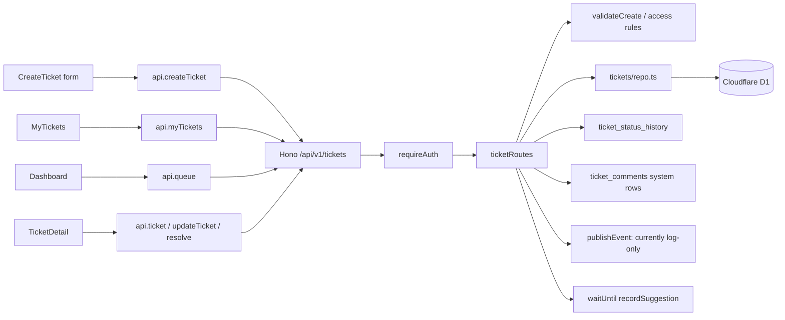

# Ticket Lifecycle: จากแบบฟอร์มถึงคิว admin และ D1

บทนี้ตาม ticket workflow จาก frontend ไป backend และ database โดยแยก **สถานะตามที่ต้องการ** ออกจาก **สิ่งที่ implementation ทำจริง** จุดสำคัญคือ source มี lifecycle ที่ออกแบบไว้ แต่ validation การเปลี่ยน status ยังเป็น TODO และ test สำหรับ transition ถูก skip อยู่

## 1. ไฟล์และความรับผิดชอบ

| ไฟล์ | บทบาทใน ticket workflow |
|---|---|
| [`frontend/src/pages/CreateTicket.tsx`](../../../../frontend/src/pages/CreateTicket.tsx:14) | กรอก/submit ticket; ขอ AI triage preview เป็น action แยก |
| [`frontend/src/pages/MyTickets.tsx`](../../../../frontend/src/pages/MyTickets.tsx:12) | requester ดู ticket ของตนและเปิด detail |
| [`frontend/src/pages/Dashboard.tsx`](../../../../frontend/src/pages/Dashboard.tsx:46) | admin โหลดคิว, สรุปตัวเลข, filter/search แล้วเปิด workspace |
| [`frontend/src/components/TicketTable.tsx`](../../../../frontend/src/components/TicketTable.tsx:10) | วาดตาราง requester หรือ admin จาก ticket rows |
| [`frontend/src/components/TicketDetail.tsx`](../../../../frontend/src/components/TicketDetail.tsx:17) | แสดง detail/history และ UI สำหรับ requester edit หรือ admin triage/resolve |
| [`frontend/src/lib/useAsync.ts`](../../../../frontend/src/lib/useAsync.ts:14) | โหลด/refresh data โดยป้องกัน stale response และ update หลัง unmount |
| [`frontend/src/api/client.ts`](../../../../frontend/src/api/client.ts:63) | API methods เช่น `createTicket`, `myTickets`, `queue`, `ticket`, `updateTicket`, `resolve` |
| [`frontend/src/api/types.ts`](../../../../frontend/src/api/types.ts:3) | frontend ticket/status/priority/history types |
| [`backend/src/modules/tickets/routes.ts`](../../../../backend/src/modules/tickets/routes.ts:44) | HTTP endpoint, authorization และ orchestration ของ ticket operations |
| [`backend/src/modules/tickets/rules.ts`](../../../../backend/src/modules/tickets/rules.ts:10) | pure business rules: validation, access, editable fields, resolve check, transition stub |
| [`backend/src/modules/tickets/repo.ts`](../../../../backend/src/modules/tickets/repo.ts:10) | D1 queries, inserts, updates, history, category check และ name enrichment |
| [`backend/src/modules/events/publish.ts`](../../../../backend/src/modules/events/publish.ts:69) | ปัจจุบัน build/log event envelope; ยังไม่ได้ส่ง/persist event จริง |
| [`backend/src/modules/comments/templates.ts`](../../../../backend/src/modules/comments/templates.ts:47) | บันทึก automatic chat message เมื่อเริ่มงานหรือ resolve |
| [`database/schema.sql`](../../../../database/schema.sql:33) | D1 tables, constraints, indexes, ticket history และ comments |
| [`database/migrations/0003_drop_assigned_status.sql`](../../../../database/migrations/0003_drop_assigned_status.sql:1) | แปลง ticket เก่าจาก `assigned` เป็น `in_progress` และเพิ่ม history row |
| [`backend/test/tickets.rules.test.ts`](../../../../backend/test/tickets.rules.test.ts:19) | tests สำหรับ create/access/triage/resolve; lifecycle tests ปัจจุบัน skip |

`TicketDetail` มี UI การส่งงานไป Maintenance ด้วย ซึ่งเป็น integration แยก: บทนี้อธิบายเฉพาะจุดที่เชื่อมกับ ticket state และชี้รายละเอียดการส่ง work order ไปบท Maintenance เมื่อวิเคราะห์โมดูลนั้น

## 2. สถาปัตยกรรมการเรียก



`requireAuth` is installed for `/tickets` in [`backend/src/index.ts`](../../../../backend/src/index.ts:44). Frontend role-based navigation is not the only access control: routes also call `canViewTicket`, `editableFields`, `canResolve`, and `isStaff` on the server

## 3. Type/data model ที่ใช้กับ ticket

### 3.1 Status และ priority

Backend [`STATUSES`](../../../../backend/src/modules/tickets/rules.ts:11) คือ `open`, `in_progress`, `resolved`, `closed`; `PRIORITIES` คือ `low`, `medium`, `high`, `urgent`. `Ticket` type มี ticket identity, text, status/priority/category/customer, legacy assignee field, timestamps, maintenance references และ advisory `ai_*` fields.

Frontend [`TicketStatus`](../../../../frontend/src/api/types.ts:3) ไม่รวม `assigned`; client `fix()` ที่อธิบายไว้ใน frontend foundation เปลี่ยน status เก่าที่รับมาเป็น `in_progress` เพื่อไม่ให้ UI เจอ status ที่ไม่รู้จัก

### 3.2 D1 tables หลัก

- `tickets`: แถว business state ปัจจุบัน; `ticket_number` unique; มี FK ไป `ticket_categories`; customer/assignee เป็น identity references โดยไม่มี FK ไป users table.
- `ticket_categories`: category name และ active flag; ticket create/update ตรวจว่าหมวดที่เลือกยัง active.
- `ticket_status_history`: บันทึก from/to, actor, source, note และเวลา; FK ticket พร้อม `ON DELETE CASCADE`.
- `ticket_comments`: comments รวม automatic system messages; FK ticket พร้อม cascade.
- `user_profiles`: เฉพาะ guest identity/profile ที่ Helpdesk เก็บเอง; display names ถูก join/enrich ใน code ไม่ได้เก็บซ้ำใน ticket.
- `tickets.ai_category_id`, `ai_priority`, `ai_route`, `ai_source`: advisory triage fields; ชื่อ category ที่แสดงถูก join จาก `ticket_categories`.

Index ที่เกี่ยวกับ query ได้แก่ status, customer, agent, category และ queue composite `(status, priority, created_at)`; repository list ยังมี hard limit 200 rows และไม่มี pagination parameter

## 4. สร้าง ticket: ผู้ใช้กด Submit

### 4.1 Frontend

ใน [`CreateTicket`](../../../../frontend/src/pages/CreateTicket.tsx:14), component โหลด active categories ด้วย `useAsync(() => api.categories(), [])` แล้วเก็บ input แยกเป็น React state: `subject`, `description`, `categoryId`, `urgency`, field errors, submit state และ created ticket.

เมื่อ submit:

1. ป้องกัน native form submit ด้วย `e.preventDefault()`.
2. ตั้ง `submitting`, clear error/field errors.
3. เรียก `api.createTicket({ subject, description, category_id: Number(categoryId), urgency })`.
4. shared client ส่ง `POST /api/v1/tickets` พร้อม JSON และ current identity headers.
5. success เก็บ `Ticket` ใน `created`; UI เปลี่ยนเป็น confirmation ที่แสดง `ticket_number`, และ link ไป `#/my/<id>`.
6. `ApiError.fields` ถูกใช้แสดง field validation; `finally` reset `submitting`.

HTML `maxLength` และปุ่ม/required state ช่วย UX เท่านั้น; backend ยังคง validate ซ้ำ

### 4.2 Backend route และ validation

[`POST /tickets`](../../../../backend/src/modules/tickets/routes.ts:57) อ่าน verified user จาก Hono context, parse body ด้วย `readJson()` และส่งให้ [`validateCreate(body)`](../../../../backend/src/modules/tickets/rules.ts:61).

`validateCreate` รองรับทั้ง PRD field names (`subject`, `urgency`) และ legacy names (`title`, `priority`), trim title/description, แปลง category id เป็น number แล้วตรวจ:

- title/subject 5–150 characters
- description 10–5,000 characters
- category id เป็น positive integer
- priority อยู่ใน allowlist

เมื่อผิด route คืน 422 `ValidationError` พร้อม `fields`. เมื่อถูกต้อง rules normalize เป็น `{ title, description, category_id, priority, customer_id? }`.

Route จากนั้น:

1. กำหนด `customerId = input.customer_id ?? user.id`.
2. requester ที่ไม่ใช่ admin สร้างแทน user คนอื่นไม่ได้; admin ระบุ `customer_id` ได้ ถ้า identity lookup สำเร็จ.
3. ตรวจ customer identity ผ่าน `findIdentity` และตรวจ category ด้วย `categoryIsActive`.
4. `insertTicket` เขียนแถว ticket แล้วได้ integer id.
5. `recordStatus` เพิ่ม history `from_status = null`, `to_status = open`, actor เป็น user ปัจจุบัน, source `helpdesk`, note `Ticket created`.
6. โหลด ticket row กลับ, เรียก `publishEvent('ticket.created', ticket)`, ลงทะเบียน AI background work ด้วย `executionCtx.waitUntil(...)`.
7. `named()` enrich customer name แล้วคืน HTTP 201 `{ message, data }`.

### 4.3 Repository insert และเลข ticket

ใน [`insertTicket(db, input)`](../../../../backend/src/modules/tickets/repo.ts:48):

```sql
INSERT INTO tickets (ticket_number, title, description, priority, category_id, customer_id)
VALUES (?, ?, ?, ?, ?, ?)
```

ขั้นแรกใช้ `TMP-${crypto.randomUUID()}` เป็น ticket number ชั่วคราว เพื่อ insert ได้แม้ id ยังไม่รู้. อ่าน `res.meta.last_row_id`, สร้างเลขจาก [`ticketNumber(id)`](../../../../backend/src/modules/tickets/rules.ts:44) เช่น id `12` → `TKT-00012`, แล้ว update row ให้เป็นเลขจริง. สอง statement นี้ถูก await แยกกัน ไม่ได้อยู่ใน transaction ที่เห็นใน repository; หาก statement ที่สองล้มเหลว หลัง insert แรกอาจเหลือ temporary number.

### 4.4 Event และ background triage ใน implementation ปัจจุบัน

- [`publishEvent`](../../../../backend/src/modules/events/publish.ts:69) สร้าง envelope แล้ว log `event (not yet delivered — TODO P2)`; TODO ใน source ระบุว่าควร insert `domain_events` และส่ง Notification Hub ในอนาคต. ปัจจุบันการเรียกนี้ **ไม่ได้เขียน outbox หรือส่ง event ออก**.
- [`recordSuggestion`](../../../../backend/src/ai/record.ts:9) เป็น background side effect ที่อธิบายใน [`02-ai-triage.md`](02-ai-triage.md). มัน update เฉพาะ `ai_*` fields และ route สร้าง ticket ไม่รอผลนี้.

Create flow ทำหลาย D1 statements/side effects ตามลำดับ ไม่พบ `db.batch()`/transaction ครอบทั้ง insert + history + event. จึงไม่ควรสรุปว่าเป็น atomic transaction

## 5. รายการ ticket และ admin queue

### 5.1 Requester: My Tickets

[`MyTickets`](../../../../frontend/src/pages/MyTickets.tsx:12) ใช้ `useAsync(() => api.myTickets(), [user?.id])`; loading/error/empty states ถูกแยก. List mode ใช้ `TicketTable` เป็น requester mode. เมื่อมี `selectedId`, page render `TicketDetail` และส่ง `reload` เป็น `onChanged`.

Backend `GET /tickets/me` ใช้ `listTickets({ customerId: c.get('user').id })`, enrich names และคืน count/data. Ownership filter จึงเกิดใน server query ไม่ใช่เฉพาะ frontend.

### 5.2 Admin: dashboard queue

`Dashboard` โหลด `api.queue()`; API client ใส่ query `sort=queue`. Route ตรวจ status/priority filters ว่าอยู่ใน allowlist; invalid filter จะกลายเป็น `undefined` (ถูกละเลย ไม่ได้คืน validation error). ถ้าเป็น customer ที่เรียก route ได้ query จะถูกบังคับ `customerId` เป็น user id; admin อาจขอ `customer_id` filter.

[`listTickets(db, filter)`](../../../../backend/src/modules/tickets/repo.ts:33) สร้าง `WHERE` เฉพาะเงื่อนไขที่มีและ bind ค่าเป็น parameters. `sort=queue` ใช้ `QUEUE_ORDER_SQL`: urgent → high → medium → low แล้ว `created_at ASC` (ticket เก่าก่อน); sort ปกติใช้ `updated_at DESC`. Query จำกัด `LIMIT 200`.

`Dashboard` เพิ่มการ filter/search ฝั่ง browser หลังได้ list มาแล้ว:

- summary cards คำนวณจาก `all` ทั้งชุด ไม่ขึ้นกับ search/priority filter
- `rows` ใช้ active view, priority และ lowercased search ที่ match ticket number/title/requester/category
- selected row เปิด `TicketDetail`

### 5.3 Name enrichment และ detail/history

`SELECT` ใน repo left-join categories สำหรับ `category_name` และ AI category table alias `ac` สำหรับ `ai_category_name`. `attachNames()` เรียก shared `displayNames()` เพื่อเติม `customer_name` แยกจาก ticket row.

`GET /tickets/:id` ผ่าน `parseId`, `loadVisible` โหลด ticket และใช้ [`canViewTicket(user, ticket)`](../../../../backend/src/modules/tickets/rules.ts:93): admin ดูได้ทุก ticket; customer เห็นเฉพาะ `customer_id === user.id`. แล้วอ่าน `ticket_status_history` เรียง `created_at ASC, id ASC`; `getHistory()` เติม `changed_by_name` และคืน detail + history.

## 6. Edit, triage และ status transitions

### 6.1 Whitelist by role

`PATCH /tickets/:id` และ legacy alias `PUT` ใช้ `patchTicket` เดียวกัน. Requester เปลี่ยนได้เฉพาะ `title`, `description`; admin เปลี่ยนได้เพิ่ม `priority`, `status`, `category_id`, `resolution_note`, `wellbeing_service_slug`. Route สร้าง `fields` ใหม่โดยคัดเฉพาะ key จาก `editableFields(role)` ก่อน validate และ SQL; fields อื่นจาก client ถูกละเลย ไม่ถูก mass-assigned.

Requester edit ถูกปฏิเสธ 409 ถ้า ticket ไม่ใช่ `open`. `TicketDetail.RequesterEdit` จึงแสดง form เฉพาะ requester + status open และปุ่ม save disable เมื่อค่าคงเดิมหรือสั้นเกิน; backend ยังโหลด/ตรวจ status เอง.

### 6.2 Admin triage และเริ่มงาน

`TicketDetail.AdminActions` เริ่ม local state จาก category/priority ของ ticket. ปุ่ม **Save triage** เรียก `api.updateTicket` โดยส่ง category/priority; route อนุญาตให้ admin เปลี่ยน fields เหล่านี้และตรวจ priority/category ว่ายังใช้ได้.

ปุ่ม **Start work** ส่ง PATCH `{ status: 'in_progress', priority, category_id }`. Backend update ticket, บันทึก status history เมื่อสถานะเปลี่ยน และถ้าเปลี่ยนจาก `open` เป็น `in_progress` เรียก `postSystemMessage(..., MESSAGES.started)`. Message helper ใช้ D1 `batch()` insert แถว `ticket_comments` author id 0 พร้อม bump `tickets.updated_at`; helper จับ/log failure ไม่โยนกลับ.

สำหรับ Facility/repair UI อาจส่ง Team 10 ต่อหลัง update status สำเร็จ; หาก send ล้มเหลว state ticket ยัง `in_progress` และ UI เตือนว่าส่งซ้ำได้. การส่ง work order เป็น API integration แยก ไม่ใช่ rollback ของการเริ่มงาน.

### 6.3 สถานะที่ตั้งใจไว้ เทียบกับที่ enforce จริง

Rules document เสนอ lifecycle:

```text
open → in_progress → resolved → closed
```

แต่ [`canTransition(from, to)`](../../../../backend/src/modules/tickets/rules.ts:126) ปัจจุบัน `return true` ทุกคู่ พร้อม TODO. `patchTicket` เรียกมันแต่ไม่ได้บังคับ transition จริง. ดังนั้น admin ที่ผ่าน field whitelist สามารถเปลี่ยนไปยัง status ใดก็ได้ใน `STATUSES`, รวมถึง transition ที่ intended lifecycle ไม่อนุญาต.

`backend/test/tickets.rules.test.ts` มี describe `Lifecycle` ที่ถูก `describe.skip(...)`; comments ระบุให้เอา `.skip` ออกหลัง implement `canTransition`. นี่คือ known incomplete behavior ไม่ใช่แค่ test coverage ที่คาดเดา

## 7. Resolve และ delete

### Resolve endpoint

UI `AdminActions` ต้องมี resolution summary ที่ trim แล้วอย่างน้อย 5 ตัวอักษร และกด confirm ก่อนเรียก `api.resolve(id, note)`.

Backend `POST /tickets/:id/resolve`:

1. โหลด verified user และ ticket ที่ user มองเห็นได้.
2. เรียก [`canResolve(user, ticket)`](../../../../backend/src/modules/tickets/rules.ts:108): customer ถูกปฏิเสธ; admin ถูกปฏิเสธถ้า status เป็น `resolved` หรือ `closed`.
3. อ่าน JSON body; `.catch(() => ({}))` ทำให้ malformed/empty body กลายเป็น body ว่าง.
4. trim `resolution_note`, ว่างกลายเป็น `null`.
5. update `status='resolved'`, `resolved_at`, `resolution_note`, `updated_at`.
6. เพิ่ม status history, post system message, โหลด ticket ใหม่, เรียก event publisher แล้วคืน response.

Backend route นี้ไม่ได้ enforce note ขั้นต่ำ 5 ตัวอักษร; ข้อกำหนดขั้นต่ำมีใน UI เท่านั้น. `canResolve` ไม่บังคับว่าเดิมต้องเป็น `in_progress`, จึง admin สามารถ resolve ticket ที่ยัง `open` ผ่าน endpoint นี้ได้.

อีกทางหนึ่ง admin PATCH สามารถส่ง `status: 'resolved'`; route จะตั้ง `resolved_at` และ history/message/event. PATCH ไป `closed` ไม่ได้ตั้ง `resolved_at` ใน branch นี้ เพราะ assignment ของ timestamp เกิดเฉพาะเมื่อ `to === 'resolved'`.

เมื่อ resolved/closed, `TicketDetail` แสดง outcome และซ่อน `AdminActions`; requester เห็น resolution note และ status.

### Delete endpoint

`DELETE /tickets/:id` ใช้ `loadVisible`, ปฏิเสธ resolved/closed ด้วย 409 แล้วลบแถว ticket ด้วย parameterized id. เนื่องจาก requester ผ่าน visibility check สำหรับ ticket ของตนเองได้ route ปัจจุบันจึงเปิดให้ requester ลบ ticket ที่ยังไม่ resolved/closed ของตนได้ด้วย (และ admin ลบได้ทุก ticket). Schema FK แบบ cascade จะลบ status history, comments และ tags ที่ผูกไว้; ไม่มีการเขียน audit history ของการลบใน handler นี้

## 8. Real execution trace: requester สร้างและ admin เริ่มงาน

ตัวอย่าง input จากฟอร์ม:

```json
{
  "subject": "Air conditioner in B-204 is broken",
  "description": "The room has been hot since this morning and the unit will not start.",
  "category_id": 5,
  "urgency": "high"
}
```

1. Frontend client POST body และ headers ไป `/api/v1/tickets`.
2. `requireAuth` resolve `x-user-id`/role; create handler reads `c.get('user')`.
3. `validateCreate` normalize: `title` จาก subject, description trimmed, category 5, priority `high`.
4. Route ตรวจ customer identity และ category 5 active.
5. `insertTicket` insert temp number, รับ D1 row id (สมมติ 12), update `ticket_number = 'TKT-00012'`.
6. `recordStatus` insert `(ticket_id=12, from_status=null, to_status='open', changed_by=<requester>, source='helpdesk', note='Ticket created')`.
7. Handler fetches row; event function log-only; `waitUntil` starts advisory suggestion write; response status 201 includes named ticket.
8. Requester `GET /tickets/me` gets their own ticket; admin `GET /tickets?sort=queue` sees queue order; detail endpoint adds history.
9. Admin selects/keeps category and priority then PATCHes status `in_progress`; `patchTicket` updates row, adds history `open → in_progress`, and system comment; success response has refreshed ticket.

Exact D1 row id/output are illustrative values; actual id is assigned by D1. Ticket number calculation and statement order are based on the repository implementation

## 9. Tests and potential breakage

### Tests

[`backend/test/tickets.rules.test.ts`](../../../../backend/test/tickets.rules.test.ts:19) covers `validateCreate`, `ticketNumber`, visibility, requester/admin editable-field allowlists and `canResolve`. Lifecycle tests for intended transitions are skipped. Test file is rule-level; it does not exercise the full D1 route workflow.

Targeted run: `npx vitest run backend/test/tickets.rules.test.ts` passed with 10 tests passed and 2 lifecycle tests skipped.

### Important gaps/risks confirmed by source

1. `canTransition` always returns true; intended lifecycle not enforced.
2. PATCH validates title minimum but not its 150-character maximum; it does not enforce description min/max. Browser controls have `maxLength`, but API callers can bypass HTML.
3. `/resolve` accepts empty or malformed body as no note and does not enforce UI's 5-character summary rule.
4. `canResolve` blocks double-resolve but permits resolving from `open`.
5. Ticket insert, history insert, event logging, and AI background work are not a single atomic database transaction; failures can leave partial side effects.
6. `publishEvent` does not yet persist to `domain_events` or send outbound events; its own source labels this TODO.
7. Queue query truncates at 200 without pagination; callers cannot fetch later rows through this API contract.
8. Customer `DELETE` is permitted for their own unresolved ticket by the current `loadVisible`/status checks; destructive behavior should be considered before changing UI/server permissions.
9. `insertTicket` uses separate insert/update for temporary/final ticket number; failure after first statement may leave the temporary number.
10. Changing DB status CHECK, migration, `STATUSES`, frontend type, or compatibility `fix()` independently can create status mismatches.

## 10. Scope still pending

This article traces core ticket operations and identifies Maintenance, comments/chat, escalation, admin features, and full schema/migration analysis as related modules that need separate source review. Current file-by-file status is tracked in [`DOCUMENTATION_PROGRESS.md`](../../DOCUMENTATION_PROGRESS.md)
