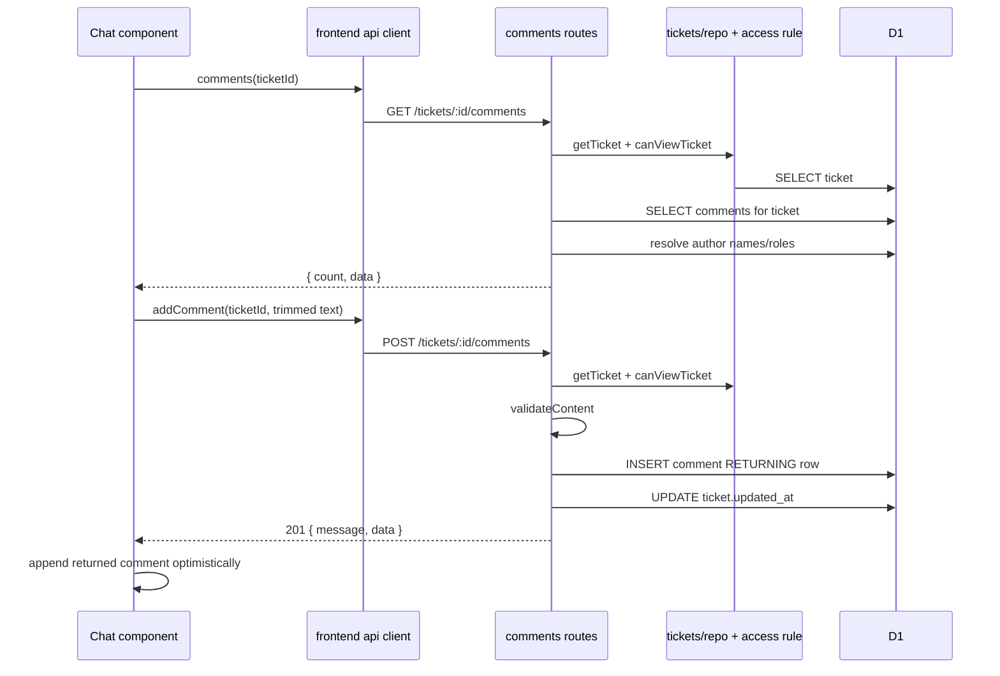

# Comments & Chat: การสนทนาต่อ ticket และ system messages

ระบบแชทมีหนึ่ง conversation ต่อหนึ่ง ticket ใช้ตาราง `ticket_comments` ร่วมกันทั้งข้อความจาก requester/admin และข้อความระบบอัตโนมัติ ไม่มี internal-note workflow ใน API ปัจจุบัน และไม่ได้ใช้ WebSocket/push; หน้าเว็บ poll ข้อมูลเป็นช่วง ๆ

## 1. ไฟล์และความสัมพันธ์

| ไฟล์ | หน้าที่ |
|---|---|
| [`backend/src/modules/comments/routes.ts`](../../../../backend/src/modules/comments/routes.ts:29) | list/post comments, ตรวจว่า caller มองเห็น ticket ได้, เติมชื่อ/role ผู้เขียน |
| [`backend/src/modules/comments/rules.ts`](../../../../backend/src/modules/comments/rules.ts:9) | comment type และ pure content validation |
| [`backend/src/modules/comments/templates.ts`](../../../../backend/src/modules/comments/templates.ts:10) | system author id, ข้อความเหตุการณ์ และ posting แบบ best-effort |
| [`frontend/src/pages/Messages.tsx`](../../../../frontend/src/pages/Messages.tsx:21) | เลือก conversation ตาม role, filter/list, layout และ ticket side panel |
| [`frontend/src/components/Chat.tsx`](../../../../frontend/src/components/Chat.tsx:17) | โหลด/poll/render/send ข้อความของ ticket หนึ่งรายการ |
| [`frontend/src/api/client.ts`](../../../../frontend/src/api/client.ts:91) | `comments(id)` และ `addComment(id, content)` ผ่าน shared HTTP client |
| [`frontend/src/api/types.ts`](../../../../frontend/src/api/types.ts:47) | `Comment` shape สำหรับข้อความจาก API |
| [`backend/src/modules/tickets/rules.ts`](../../../../backend/src/modules/tickets/rules.ts:93) | `canViewTicket` ใช้ร่วมกันกำหนดสิทธิ์เห็น conversation |
| [`backend/src/core/profiles.ts`](../../../../backend/src/core/profiles.ts:43) | แปลง author ids เป็น display names รวม guest profiles |
| [`database/schema.sql`](../../../../database/schema.sql:87) | `ticket_comments` table, FK, visibility check และ index |
| [`database/migrations/0004_guest_profiles.sql`](../../../../database/migrations/0004_guest_profiles.sql:1) | ลบ internal rows เดิม แต่คง `visibility` column ไว้ |
| [`backend/test/comments.test.ts`](../../../../backend/test/comments.test.ts:11) | tests ของ content rules, profile rules และ repair system message rules |

## 2. ภาพ data flow

System messages follow a separate path: ticket/maintenance handler calls `postSystemMessage()`, which batches insert + ticket timestamp update; failures are logged and swallowed. The Maintenance module calls `repairMessage()` to decide whether a webhook status change deserves an automatic message; integration details remain in its own module documentation

## 3. Backend rules and data shape

### 3.1 Comment type and validation

[`Comment`](../../../../backend/src/modules/comments/rules.ts:9) contains `id`, `ticket_id`, `author_id`, `content`, `created_at`. `author_name` and `author_role` are derived fields added by route serialization, not stored in that base row type.

[`validateContent(content)`](../../../../backend/src/modules/comments/rules.ts:18) is pure:

1. If input is not a string, use `''`; otherwise trim it.
2. Empty after trim returns `Please type a message`.
3. More than 2,000 characters returns a length error.
4. Otherwise return `null` meaning valid.

The validator does not mutate input and does not read D1. Database insert also stores the trimmed string because the POST handler trims after validation

### 3.2 Shared access check

[`loadVisibleTicket(c)`](../../../../backend/src/modules/comments/routes.ts:45) reads `:id` through `parseId`, calls `getTicket`, returns 404 if absent, then calls `canViewTicket(c.get('user'), ticket)`. Admin may view all; requester may view only a ticket whose `customer_id` equals their verified user id. Both GET and POST call this helper, so API access is enforced even if a conversation is opened by manually changing the URL

The route itself does not distinguish comments on open vs resolved/closed tickets; anyone permitted to view the ticket can post as long as content validation succeeds

### 3.3 `withAuthors`: derived attribution

[`withAuthors(db, rows)`](../../../../backend/src/modules/comments/routes.ts:35):

- Calls `displayNames()` for author ids excluding `SYSTEM_AUTHOR_ID` (0).
- If `author_id === 0`, writes derived `author_name = 'Automatic update'` and `author_role = 'system'`.
- Otherwise name comes from identity directory/guest profiles; role uses `verify(author_id)?.role ?? 'customer'`.
- Returns copied rows with added fields; stored comment rows are unchanged.

Guest ids are not in the static `verify()` directory, so the default role is customer; `displayNames()` can still resolve their display name from `user_profiles`

## 4. HTTP routes in source order

### `GET /tickets/:id/comments?after=<id>`

[`commentRoutes.get(...)`](../../../../backend/src/modules/comments/routes.ts:52):

1. Load ticket and enforce visibility.
2. Convert query `after` to number; missing/non-numeric values fall back to 0 via `Number(...) || 0`.
3. Parameterized query selects `id, ticket_id, author_id, content, created_at` for same ticket where `id > after`, ordered by id ascending.
4. Pass results (or empty array) through `withAuthors()`.
5. Return `{ count: rows.length, data: rows }` with status 200.

The `after` cursor can support incremental polling, but current frontend method `api.comments(id)` does not pass it. `Chat` polls the full conversation endpoint; server support for incremental reads is not used by this client

### `POST /tickets/:id/comments`

[`commentRoutes.post(...)`](../../../../backend/src/modules/comments/routes.ts:65):

1. Read authenticated `user` from Hono context and load visible ticket.
2. `readJson<{ content?: unknown }>()` parses JSON; malformed JSON follows shared HTTP helper behavior (400).
3. Validate `body.content`; invalid content throws `badRequest`, which becomes status 400.
4. Trim content and insert `(ticket_id, author_id, content)` with bound parameters; `RETURNING` gives inserted comment row.
5. Separately update `tickets.updated_at = datetime('now')` so My Tickets and Messages sort by latest activity.
6. Add derived author data and return status 201 `{ message: 'Comment added', data }`.

The INSERT and timestamp UPDATE are separate awaited calls, not one batch/transaction. If the insert succeeds and the timestamp update fails, the message may be stored although client receives an error response

## 5. System messages and templates

### 5.1 System author

[`SYSTEM_AUTHOR_ID`](../../../../backend/src/modules/comments/templates.ts:11) is `0`; regular demo users start at 1 and guest ids at 1000. `SYSTEM_AUTHOR_NAME` is `Automatic update`. Schema requires `ticket_comments.author_id` but does not define an FK to users, allowing this reserved synthetic id

### 5.2 Message text and repair-stage dedupe

`MESSAGES` in [`templates.ts`](../../../../backend/src/modules/comments/templates.ts:14) defines messages for work started, sent to Maintenance, repair started/done/cancelled, and resolved. `MESSAGES.resolved(note)` includes a summary only when note is non-empty.

[`repairMessage(previous, next)`](../../../../backend/src/modules/comments/templates.ts:27) maps external status strings into coarse stages:

- `in_progress` → `working`
- `completed` or `closed` → `done`
- `cancelled` → `cancelled`
- all other values (including `null`, `reported`, `assigned`) → `waiting`

If previous and next map to the same stage it returns `null`; otherwise returns a message for working/done/cancelled. Moving into waiting yields `null`, because the sent-to-Maintenance message already announced the repair. This deduplicates repeated webhook statuses and avoids reporting every status string as a new chat event

### 5.3 Persist without breaking the action

[`postSystemMessage(db, ticketId, content)`](../../../../backend/src/modules/comments/templates.ts:47) uses `db.batch()` for:

1. Insert into `ticket_comments` with author id 0 and default `visibility`.
2. Update ticket `updated_at`.

It catches any error and logs a warning rather than throwing. This is best-effort: a ticket status/maintenance action can still succeed even if the automatic chat message fails. In contrast, user comment POST awaits its insert and timestamp update without this swallow-and-log wrapper

## 6. Frontend conversation selection and polling

### 6.1 `Messages` page

[`Messages({ selectedId })`](../../../../frontend/src/pages/Messages.tsx:21):

- Detects role with `isStaff(user)`; admin list comes from `api.queue()`, customer list from `api.myTickets()`.
- Sorts ticket copies by `updated_at` descending; a new comment changes the timestamp via server handler.
- Applies status/priority/search filters in browser memory; search checks ticket number/title/requester display name.
- For an unfiltered wide-screen view, selects the newest conversation using `window.location.replace('#/chat/<id>')`.
- Polls list via `refresh()` every 15 seconds while tab is visible; cleans up interval on unmount.
- `selected` is found only in the loaded ticket list. If a `selectedId` is not present after loading, it displays “Ticket not found”; server access checks still protect comment endpoints.
- Renders `Chat key={selected.id}` in the middle, and separate ticket detail/status information at right.

`useAsync.refresh()` is a quiet refresh: it preserves current display/loading state and only applies the latest request. The list poll refreshes updated order and times; the conversation poll fetches message rows

### 6.2 `Chat` component

[`Chat({ ticketId })`](../../../../frontend/src/components/Chat.tsx:35) loads `api.comments(ticketId)` with `useAsync`; its dependencies include ticket and current user id. While there is no error, a timer calls quiet `refresh()` every 8 seconds only when `document.hidden` is false. Cleanup clears timer. The component scrolls the log to the bottom when message count or ticket id changes

[`arrange(list, myId)`](../../../../frontend/src/components/Chat.tsx:18) converts each `Comment` into UI metadata:

- `mine`: `author_id === myId`
- `first`/`last`: adjacent messages are grouped only when both are non-system, same author, same calendar day, and within five minutes
- `day`: add a day divider when there is no previous message or date changes
- system messages never join a normal message burst

Sending behavior in `send(e?)`:

1. Optional form event is prevented.
2. Trim current text; return if empty or already sending.
3. Set busy state and clear prior send error.
4. Call `api.addComment(ticketId, body)`.
5. On success clear input and append returned server row to current data for immediate display; polling later resynchronizes.
6. On failure keep the text and show the error; `finally` clears sending state.

Textarea enforces `maxLength=2000` in browser UX, grows to at most 140px, sends on Enter when not Shift+Enter and not in IME composition, and submits on button/form. Backend still validates the same maximum, so HTTP callers cannot bypass server rules

## 7. Real execution example

Suppose requester id 1000 opens `#/chat/12`, types `The projector is still blank`, then sends:

1. App route renders `Messages(selectedId=12)`; list uses requester `api.myTickets()`; selected ticket opens `<Chat ticketId={12}>`.
2. Chat initial `useAsync` calls `GET /api/v1/tickets/12/comments` with shared client identity headers.
3. Backend auth middleware verifies the user; comments GET loads ticket 12, checks requester ownership, queries all comment rows ordered by id, and enriches guest names from `user_profiles`.
4. User presses Send; frontend trims text and POSTs JSON `{ content: 'The projector is still blank' }`.
5. Backend confirms same ownership, accepts the trimmed content, inserts one row with `author_id=1000`, updates `tickets.updated_at`, and returns 201 with author name/role.
6. Frontend clears input and appends returned row; it appears as requester’s right-side bubble. The next 8-second poll fetches the conversation list again.

Exact response id/timestamp are assigned at runtime by D1; example demonstrates the data transformations visible in the source

## 8. Tests and limitations

[`backend/test/comments.test.ts`](../../../../backend/test/comments.test.ts:33) verifies:

- `validateContent` rejects empty/whitespace and over-2,000 characters, accepts exactly 2,000 and normal text
- `repairMessage` announces stage changes once, ignores repeated/waiting statuses, includes resolution summary when supplied
- system author id is neither static identity nor guest
- guest profile validation/ID behavior (covered here as well)

The test file exercises pure rules/templates; it does not contain an HTTP route/D1 integration test for GET/POST comments or a browser test for polling/rendering

Current limitations visible in source:

1. No unread count/last-seen tracking.
2. No `ticket.commented` domain event is published; this is a TODO in route comments.
3. No special reopen/flag behavior when a requester comments on a resolved ticket.
4. No WebSocket/server push; frontend polling is 8 seconds for messages and 15 seconds for list updates while visible.
5. API supports `after` cursor, but the current frontend fetches the full conversation every poll.
6. No internal-note UI/API; `visibility` is legacy schema state, and migration 0004 removes existing internal rows.
7. System message write errors are swallowed and only appear in server logs.

## 9. Scope not covered here

This chapter covers comments/chat behavior and the system-message interface. Ticket state transitions that call templates are in [`03-ticket-lifecycle.md`](03-ticket-lifecycle.md); Maintenance webhook mapping that selects repair messages will be analyzed separately. File/function inventory remains in [`DOCUMENTATION_PROGRESS.md`](../../DOCUMENTATION_PROGRESS.md)
