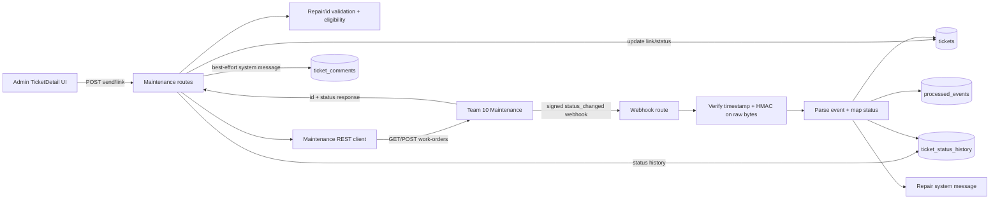

# Maintenance Integration: work orders, signed webhooks, and ticket updates

ระบบเชื่อม Team 14 Helpdesk กับ Team 10 Maintenance ด้วยสอง flow: admin ส่ง work order จาก Helpdesk หรือ link work order ที่สร้างไว้แล้ว และ Team 10 ส่ง signed webhook เพื่ออัปเดตสถานะงานซ่อมกลับมา

ระบบ Helpdesk เก็บ `maintenance_work_order_id`, สถานะล่าสุด และเวลาที่ได้รับสถานะ ไม่เก็บ copy ของ case/ข้อมูลส่วนตัวของระบบ Maintenance ตาม schema/route ที่ตรวจ อย่างไรก็ตาม text fields ที่ admin ส่งเป็น free text จึงไม่มีตัวกรอง PII อัตโนมัติ

## 1. Files และขอบเขต

| ไฟล์ | หน้าที่ |
|---|---|
| [`backend/src/modules/maintenance/routes.ts`](../../../../backend/src/modules/maintenance/routes.ts:26) | admin send/link routes และ inbound webhook processing |
| [`backend/src/modules/maintenance/client.ts`](../../../../backend/src/modules/maintenance/client.ts:7) | HTTP client ไป Team 10: GET work order และ POST create |
| [`backend/src/modules/maintenance/envelope.ts`](../../../../backend/src/modules/maintenance/envelope.ts:7) | repair body, work-order-id และ webhook envelope validation |
| [`backend/src/modules/maintenance/mapping.ts`](../../../../backend/src/modules/maintenance/mapping.ts:27) | map Team 10 status → Helpdesk state effect |
| [`backend/src/modules/maintenance/signature.ts`](../../../../backend/src/modules/maintenance/signature.ts:14) | HMAC-SHA256, safe compare และ webhook freshness validation |
| [`frontend/src/components/TicketDetail.tsx`](../../../../frontend/src/components/TicketDetail.tsx:251) | admin UI สำหรับ start/send, manual link และ repair status |
| [`frontend/src/api/client.ts`](../../../../frontend/src/api/client.ts:96) | client methods `sendWorkOrder` และ `linkWorkOrder` |
| [`backend/src/modules/tickets/repo.ts`](../../../../backend/src/modules/tickets/repo.ts:64) | update ticket fields/status history helpers |
| [`backend/src/modules/comments/templates.ts`](../../../../backend/src/modules/comments/templates.ts:14) | messages ที่บอก requester ว่าส่งงาน/มี repair progress |
| [`database/schema.sql`](../../../../database/schema.sql:48) | maintenance columns และ unique partial index ต่อ work-order id |
| [`backend/test/maintenance.test.ts`](../../../../backend/test/maintenance.test.ts:11) | unit tests สำหรับ signature, validation, mapping และ REST client |
| [`scripts/send-mock-maintenance-event.mjs`](../../../../scripts/send-mock-maintenance-event.mjs:13) | ส่ง webhook จำลองพร้อม HMAC สำหรับ dev/demo |

## 2. ภาพ architecture



Webhook route ไม่ใช้ `requireAuth` เพราะ caller เป็น service Team 10; protection คือ HMAC signature/timestamp. Admin send/link routes ใช้ `requireRole('admin')` และอยู่ใต้ `/tickets` auth middleware ที่ติดตั้งใน [`backend/src/index.ts`](../../../../backend/src/index.ts:44)

## 3. Shared validation และ data contract

### 3.1 Work-order categories และ repair request

[`REPAIR_CATEGORIES`](../../../../backend/src/modules/maintenance/envelope.ts:12) มีค่าแบบ case-sensitive 5 ค่า: `Plumbing`, `Electrical`, `HVAC`, `Safety`, `Not sure`.

[`validateRepairRequest(body, fallback)`](../../../../backend/src/modules/maintenance/envelope.ts:22):

1. ถ้า title/description เป็น string ใช้ค่านั้น; มิฉะนั้น fallback ไป ticket title/description; ทุกค่าถูก trim.
2. location/category ไม่มี fallback นอกจาก empty string.
3. title ต้อง 3–150 chars.
4. location ต้อง 2–200 chars.
5. category ต้องตรงหนึ่งในห้าค่า.
6. description ต้อง 5–5,000 chars.
7. คืน `{ ok: true, title, description, location, category }` หรือ `{ ok: false, message }`.

Validation นี้ตรวจ shape/length/category เท่านั้น ไม่ได้ detect/redact names, email หรือ phone. UI ให้คำแนะนำ admin ลบข้อมูลส่วนตัวก่อนส่ง แต่ server ไม่รับประกันว่า free text ปลอด PII

### 3.2 Work order ID

[`validateWorkOrderId(value)`](../../../../backend/src/modules/maintenance/envelope.ts:51) trim string, ปฏิเสธค่าว่าง, ปฏิเสธ Helpdesk reference ที่ขึ้นต้น `TKT-`, และยอมรับเฉพาะ regex `^[A-Za-z0-9._-]{1,64}$`. การจำกัดอักขระสำคัญเพราะ id ถูกนำไปต่อ URL path และต้องไม่สับสนกับ ticket number ของเรา

### 3.3 Webhook envelope

[`parseWebhookEvent(body)`](../../../../backend/src/modules/maintenance/envelope.ts:60) คาดรูป:

```json
{
  "eventId": "unique-event-id",
  "type": "maintenance.status_changed",
  "data": {
    "workOrderId": "WO-0045",
    "status": "in_progress"
  }
}
```

ตรวจ event id (string, ไม่ว่าง, ≤128), type คงที่ `maintenance.status_changed`, workOrderId (≤64) และ status (≤64). `source`, `subject`, `occurredAt`, `previousStatus` และ extra keys ถูก parser นี้ไม่ใช้; parsed `WebhookEvent` มีเฉพาะ id/type/workOrderId/status. String length check ใช้ `v.length` ก่อน trim แล้วคืน trimmed value

## 4. Team 10 REST client

### 4.1 Shared behavior

[`MAINTENANCE_TIMEOUT_MS`](../../../../backend/src/modules/maintenance/client.ts:14) เท่ากับ 3,000 ms. Client ตัด trailing `/` จาก `MAINTENANCE_API_URL`, ส่ง `X-Correlation-Id`, optional `Authorization: Bearer ...` เมื่อมี API key และใช้ `AbortSignal.timeout(3000)`. Network/timeout/invalid response ถูกแปลงเป็น tagged `unavailable` result ไม่ throw; route จึงตัดสินใจว่าจะตอบ 503 อย่างไร

### 4.2 `fetchWorkOrder(env, id, correlationId)`

Endpoint: `GET {base}/work-orders/{encodeURIComponent(id)}`.

- ไม่มี base URL: เฉพาะ `ENVIRONMENT === 'development'` และ id ที่ขึ้นต้น `WO-MOCK-` ได้ mock `found` result; อย่างอื่น `unavailable`.
- HTTP 404 → `not_found`.
- non-2xx อื่น → `unavailable` พร้อม `HTTP <status>`.
- 2xx: ยอมรับ body `{ data: {...} }` หรือ bare object; `status` ต้อง non-empty string. `id` หายไปจะ fallback ไป id ที่ caller ให้มา.
- catch → `unavailable` โดยใช้ error name.

### 4.3 `createWorkOrder(env, input, correlationId)`

Endpoint: `POST {base}/work-orders`, JSON `NewWorkOrder` มี `ticketRef`, title, description, location, category.

- ไม่มี base URL: development สร้าง `WO-MOCK-${uuid}` สถานะ `reported`; นอก development `unavailable`.
- HTTP 401/403 → unavailable; 404/405 → unavailable reason `create not supported` (Team 10 ยังไม่มี endpoint); other 4xx → rejected พร้อม error message ถ้ามี; server errors → unavailable.
- 2xx body รองรับ `data` wrapper หรือ bare object แต่ต้องมี `id` และ `status` เป็น non-empty strings.
- `errorMessage()` อ่าน `error.message` แบบ nested หรือ top-level `message`, trim และจำกัด 300 chars.
- catch → unavailable; function contract คือไม่ throw ไปยัง route.

`createWorkOrder` return type แยก `created`, `rejected`, `unavailable`; route map เป็น API response/error ตามชนิดนี้

## 5. Main flow: admin ส่ง work order จาก Helpdesk

### 5.1 Eligibility

[`assertReadyForRepair(ticket)`](../../../../backend/src/modules/maintenance/routes.ts:36) ปฏิเสธ:

- `resolved` หรือ `closed`
- `open` (ต้อง admin start work ก่อน)
- ticket ที่มี active work order; cancelled work order ไม่นับ active

[`hasActiveWorkOrder(ticket)`](../../../../backend/src/modules/maintenance/routes.ts:29) นิยาม active เป็นมี id และ status ไม่เท่ากับ `cancelled`; ถ้า id มีแต่ status null ก็ถือ active

### 5.2 `POST /tickets/:id/send-maintenance`

[`send-maintenance` route](../../../../backend/src/modules/maintenance/routes.ts:46):

1. `requireRole('admin')`; อ่าน JSON repair body.
2. parse ticket id, load ticket; 404 ถ้าไม่พบ.
3. ตรวจ `assertReadyForRepair`.
4. `validateRepairRequest` ใช้ ticket title/description เป็น fallback.
5. เรียก `createWorkOrder` พร้อม `ticketRef = ticket.ticket_number` และ repair payload; ส่ง correlation id.
6. Team 10 rejected → 400. unavailable → warn log และ 503 พร้อมข้อความแยกกรณี endpoint create ยังไม่เปิด/Team 10 ติดต่อไม่ได้.
7. ตรวจ response id ด้วย `validateWorkOrderId`; invalid id → 503.
8. query ว่า id นี้ถูก link กับ ticket อื่นหรือไม่; ถ้าซ้ำ → 409.
9. update เฉพาะ ticket maintenance id/status/timestamp.
10. เพิ่ม status history row โดย `from_status` และ `to_status` เท่ากับสถานะ Helpdesk ปัจจุบัน; note ระบุ work order.
11. เรียก `publishEvent('ticket.work_order_linked', ...)` (publisher ปัจจุบัน log-only) และ `postSystemMessage(MESSAGES.sentToMaintenance)` (best effort).
12. คืน ticket number, work-order id และ status.

External create เกิดก่อนการ update D1. หาก Team 10 สร้าง work order แล้ว แต่ ID ซ้ำหรือ D1 update ล้มเหลว source ไม่มี compensating delete ที่ Team 10; อาจต้อง reconcile work order ด้วยตนเอง. Unique partial index ใน `tickets` เป็น constraint ป้องกัน id ซ้ำระดับ DB เพิ่มเติม

## 6. Backup flow: admin link work order ที่มีอยู่

[`POST /tickets/:id/link-maintenance`](../../../../backend/src/modules/maintenance/routes.ts:106):

1. admin role; parse body field `work_order_id` ผ่าน `validateWorkOrderId`.
2. load ticket และตรวจ eligibility เหมือน send flow.
3. query local DB ว่า work-order id เชื่อมกับ ticket อื่นหรือไม่.
4. เรียก `fetchWorkOrder` ที่ Team 10 เพื่อยืนยันว่า id มีจริง; 404 → 400, unavailable → log warning และ 503.
5. update maintenance id/status/timestamp, เพิ่ม status-history row ที่ from/to ticket status เท่าเดิม, publish log-only event, post system message.
6. คืน id และ status.

UI จึงมีสองกรณี: auto-create จาก Helpdesk; หรือกรณีส่งไม่ได้/admin สร้างใน Team 10 แล้วจึงวาง id มา link. หน้า UI ตรวจเบื้องต้นว่า id ไม่ใช่ `TKT-...`; backend ยังตรวจซ้ำเต็มรูปแบบ

## 7. Webhook security: raw bytes, HMAC และ timestamp

### 7.1 Signature scheme

[`verifyWebhook(input)`](../../../../backend/src/modules/maintenance/signature.ts:46) ใช้:

```text
X-Timestamp: unix seconds
X-Signature: hex(HMAC-SHA256(secret, `${timestamp}.${rawBody}`))
```

ลำดับ проверки:

1. secret ไม่มี → `{ ok: false, reason: 'not configured' }`.
2. timestamp/signature ขาด → `missing headers`.
3. timestamp ไม่ใช่เลข 1–12 หลัก → `stale`.
4. ต่างจาก server time เกิน 300 seconds ทั้งอดีตหรืออนาคต → `stale`.
5. คำนวณ HMAC ด้วย Web Crypto ผ่าน [`hmacHex(secret, message)`](../../../../backend/src/modules/maintenance/signature.ts:14).
6. trim/lowercase signature ที่รับ แล้วเทียบด้วย [`safeEqual(a, b)`](../../../../backend/src/modules/maintenance/signature.ts:21): length mismatch fail; มิฉะนั้น XOR ตัวอักษรทุกตำแหน่งสะสมผลต่างก่อนตัดสิน.

### 7.2 เหตุผลที่ route อ่าน raw body ก่อน parse

ใน [`POST /webhooks/maintenance`](../../../../backend/src/modules/maintenance/routes.ts:145) handler เรียก `c.req.text()` ก่อน verify; HMAC ผูกกับ byte/string representation ที่ผู้ส่งเซ็นจริง. หลังผ่าน signature จึง `JSON.parse(rawBody)` แล้ว `parseWebhookEvent`. ถ้า parse ก่อนแล้ว stringify ใหม่ ช่องว่าง/ลำดับ key อาจเปลี่ยนและทำให้ signature contract ต่างจาก payload ที่เซ็น

secret ที่เกี่ยวข้องคือ Worker binding `MAINTENANCE_WEBHOOK_SECRET`; ไม่มี secret value อยู่ในเอกสารนี้. Missing configured secret ตอบ 503; signature failure/headers/stale ตอบ 401

## 8. Webhook mapping, dedupe และ persistence

### 8.1 Status mapping

[`mapWorkOrderStatus(status)`](../../../../backend/src/modules/maintenance/mapping.ts:27):

| Team 10 status | Helpdesk status effect | label/result |
|---|---|---|
| `reported`, `assigned` | ไม่เปลี่ยน | Sent to Maintenance |
| `in_progress` | เปลี่ยนเป็น `in_progress` ถ้า ticket ยัง active | Technician working on it |
| `completed`, `closed` | ไม่เปลี่ยนเป็น resolved | Repair done, awaiting admin confirmation |
| `cancelled` | effect เป็น `in_progress` ถ้า current ticket ยังไม่ finished | Work order cancelled by Maintenance |
| unknown | `null`; route ตอบ 400 | ไม่ process |

[`nextTicketStatus(current, effect)`](../../../../backend/src/modules/maintenance/mapping.ts:48) คืน null เมื่อ effect ไม่มี status, ticket ปัจจุบัน resolved/closed, หรือ status ไม่ต้องเปลี่ยน. Maintenance ไม่ auto-resolve ticket; admin ยังคุม resolution

### 8.2 Dedupe, unknown link, atomic batch

หลังตรวจ signature, envelope และ mapped status:

1. Query `processed_events` ด้วย `event_id`; ถ้าพบตอบ `{ received: true, duplicate: true }` status 200.
2. Query ticket ด้วย `maintenance_work_order_id`.
3. ถ้าไม่พบ ticket ที่ link id นี้ ตอบ `{ received: true, linked: false }` status 202; source ไม่ insert event id ในกรณีนี้.
4. คำนวณ `nextTicketStatus`, เตรียม update maintenance status, `maintenance_status_at`, `updated_at`, และ `status` เฉพาะเมื่อ state เปลี่ยน.
5. `DB.batch()` ทำสาม operation ร่วมกัน: insert processed event, update ticket และ insert status history. History row ถูก insert ทุก webhook ที่ผ่าน แม้ `from_status` กับ `to_status` จะเท่ากันเมื่อ ticket status ไม่ได้เปลี่ยน.
6. ถ้า batch error มีคำว่า `UNIQUE` ตอบ duplicate (รองรับ concurrent same-event race); error อื่น rethrow.
7. หลัง batch เรียก `repairMessage(previousMaintenanceStatus, newStatus)`; ถ้ามี message และ Helpdesk ticket ยังไม่ resolved/closed จึง `postSystemMessage` แบบ best effort.
8. ถ้า Helpdesk status เปลี่ยน โหลด updated ticket แล้วเรียก `publishEvent('ticket.status_changed', ...)`; publisher ที่ตรวจแล้วปัจจุบันเพียง log.
9. ตอบ `{ received: true }`.

`processed_events` dedupe ป้องกัน event ที่ถูก apply แล้วซ้ำ; timestamp window จำกัด replay เก่า แต่ webhook สำหรับ work order ที่ยังไม่ link จะไม่ถูก dedupe persist จึงอาจถูก lookup ซ้ำเมื่อ retry

## 9. Frontend integration

`TicketDetail.AdminActions` มี workflow สาม step:

1. **Triage/start:** admin เปลี่ยน category/priority และเริ่มงาน; UI อาจเลือก “Also send to Maintenance” เมื่อ category เป็น Facility.
2. **Send/link:** repair fields มี title, description, Team 10 category, location. `repairPayload()` trim values; `repairReady` เช็คความยาวขั้นต่ำก่อน enable ปุ่ม.
3. **Resolve:** แสดง repair status แต่ยังต้อง admin ยืนยันผลและ resolve เอง.

`api.sendWorkOrder(id, payload)` POST ไป `/tickets/:id/send-maintenance`; `api.linkWorkOrder(id, workOrderId)` POST ไป `/tickets/:id/link-maintenance`. On success UI reload ticket; หาก Team 10 send ล้มเหลวหลัง start-work สำเร็จ ticket คง `in_progress` และ UI เปิดทางให้ส่งซ้ำใน step 2

`maintenance_portal_url` เป็นอีกทางให้ admin เปิด Team 10 portal; UI แทน `{ticketRef}` ด้วย encoded ticket number. Portal link ไม่ใช่ REST API create/link call

## 10. Mock webhook script และ tests

[`scripts/send-mock-maintenance-event.mjs`](../../../../scripts/send-mock-maintenance-event.mjs:15) รับ positional work-order id/status และ flags สำหรับ URL, event id, correlation id, bad signature. สร้าง JSON body, HMAC ลงบน `${timestamp}.${body}` ด้วย secret ที่ operator ตั้งใน environment, ส่ง headers `X-Timestamp`, `X-Signature`, `X-Correlation-Id`, แล้วพิมพ์ HTTP response. การ reuse `--event-id` ส่งซ้ำเพื่อเช็ค dedupe.

[`backend/test/maintenance.test.ts`](../../../../backend/test/maintenance.test.ts:11) ตรวจ HMAC vector/safe compare, fresh/wrong/stale signatures, future timestamp tolerance, status mapping, ID validation, webhook shape, local mock behavior, repair request validation และ REST client POST/status/error branches. Tests ใช้ fake fetch; ไม่ได้ครอบ route + D1 batch/idempotency เป็น integration test

## 11. ข้อจำกัดและ potential failure points

1. **Contract statuses ยังต้องยืนยัน:** mapping source เองระบุ Team 10 status names เป็นค่าคาดเดาที่ยังรอยืนยัน.
2. **Free-text PII:** payload fields ไม่แนบ requester identity โดยตรง แต่ title/description/location อาจมี PII ที่ user/admin พิมพ์; UI เตือนให้ redact, backend ไม่ตรวจเนื้อหา.
3. **No external rollback:** external work order อาจถูกสร้างก่อน local D1 link ล้มเหลว.
4. **Publisher is not delivery:** `publishEvent` ยัง log-only; ไม่มี outbound event persistence/delivery ปัจจุบัน แม้ table/route call มีอยู่.
5. **Orphan webhook event:** valid webhook สำหรับ unlinked id คืน 202 โดยไม่ mark `processed_events`; retry จะตรวจซ้ำ.
6. **Status history granularity:** ทุก linked webhook insert history แม้ Helpdesk status ไม่เปลี่ยน; history row อาจมี `from_status === to_status` แต่ note/source อธิบาย Maintenance stage.
7. **Webhook test boundary:** helper tests ผ่าน แต่ full route, Hono auth boundaries, D1 atomic batch และ unique-race behavior ยังไม่มี test coverage ใน `maintenance.test.ts`.
8. **No actual external service call in docs/tests:** behavior กับ Team 10 production contract ต้องยืนยันจาก deployed service; local mocks ไม่พิสูจน์ remote API compatibility.

## 12. ยังไม่ครอบคลุม

บทนี้อธิบาย implementation ของ Maintenance module ที่ตรวจแล้ว แต่ไม่ได้อ่าน production secrets, เรียก Team 10 จริง หรือ query D1 live. Event outbox implementation และ UI shared helpers จะอธิบายใน modules แยก. สถานะ source inventory อยู่ใน [`DOCUMENTATION_PROGRESS.md`](../../DOCUMENTATION_PROGRESS.md)
