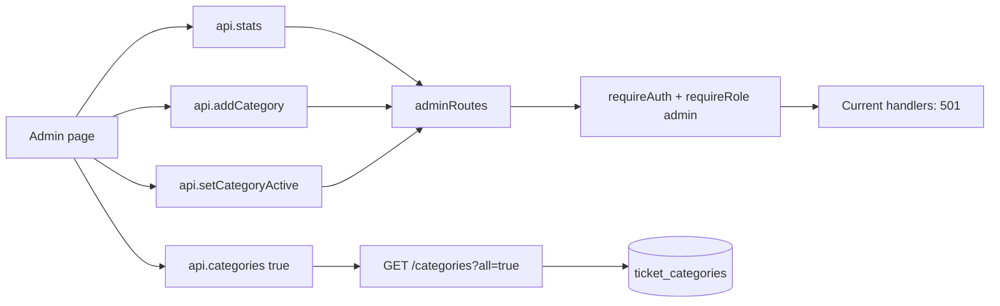

# Admin & Categories: dashboard statistics and category management

Admin UI ปัจจุบันเชื่อมกับ API contract สำหรับดูสถิติและเพิ่ม/ปิด category แต่ backend handlers ทั้งสามใน admin module ยังตอบ 501 `NotImplemented`. ส่วน category read endpoint อยู่ใน public reference module และทำงานแยกจาก admin write/stat endpoints

## 1. ไฟล์และความสัมพันธ์

| ไฟล์ | หน้าที่ |
|---|---|
| [`frontend/src/pages/Admin.tsx`](../../../../frontend/src/pages/Admin.tsx:11) | โหลด stats + category list, แสดงตาราง, add category และ toggle active |
| [`frontend/src/api/client.ts`](../../../../frontend/src/api/client.ts:104) | API methods `stats`, `addCategory`, `setCategoryActive`, `categories(all)` |
| [`frontend/src/api/types.ts`](../../../../frontend/src/api/types.ts:8) | `Category` และ `Stats` response types |
| [`backend/src/modules/admin/routes.ts`](../../../../backend/src/modules/admin/routes.ts:16) | admin route stubs สำหรับ stats/create/update category |
| [`backend/src/modules/reference/routes.ts`](../../../../backend/src/modules/reference/routes.ts:18) | category list endpoint ที่ query D1 และรองรับ `?all=true` |
| [`backend/src/core/auth.ts`](../../../../backend/src/core/auth.ts:40) | `requireRole('admin')` middleware |
| [`backend/src/index.ts`](../../../../backend/src/index.ts:47) | mount admin routes behind auth + admin role |
| [`database/schema.sql`](../../../../database/schema.sql:18) | category table, `is_active`, unique name, FK from tickets |

## 2. Architecture และ role boundary

ใน [`index.ts`](../../../../backend/src/index.ts:47) `api.use('/admin/*', requireAuth, requireRole('admin'))` ปกป้อง admin endpoints. `requireRole` อ่าน user ที่ auth middleware verify แล้วใส่ใน context. Admin page ยังถูกเลือกจาก role-aware UI route, แต่ frontend navigation ไม่ใช่ security boundary; backend guard เป็นตัวบังคับจริง

`GET /categories` อยู่ใน `referenceRoutes`, ไม่อยู่ใต้ `/admin/*` และ module comment ระบุ public/no-auth. `?all=true` ทำให้รวม categories ที่ inactive ด้วย; endpoint นี้เปิดเผย reference data เท่านั้น ไม่ใช่ write/admin API

## 3. Frontend behavior ตาม source order

### 3.1 Initial data loading

[`Admin()`](../../../../frontend/src/pages/Admin.tsx:11) สร้าง async resources แยกกัน:

- `stats = useAsync(() => api.stats(), [])`
- `cats = useAsync(() => api.categories(true), [])`

Category table จึงโหลดได้โดยไม่ต้องรอ stats response และมี loading/error state แยกต่อ panel

### 3.2 Stats panel

ถ้า `stats.loading && !stats.data` แสดง loading; `stats.error` แสดง `ErrorNotice`; ถ้ามี data แสดง:

- แถวต่อ status โดย enumerate keys จาก `STATUS_LABEL`, แสดง `by_status[s] ?? 0`.
- แถวต่อ priority จาก `PRIORITY_LABEL`, แสดง `by_priority[p] ?? 0`.
- `total` tickets.

Frontend type `Stats` คาด `{ total, by_status, by_priority }`, โดย maps เป็น partial records. แต่ backend `GET /admin/stats` ปัจจุบัน throw 501, ดังนั้น normal runtime จะเข้า error state แทน dashboard counts จนกว่า handler จะ implement

### 3.3 Category list และ toggle

หน้าเรียก `api.categories(true)`, แล้วแสดง name, description, active/disabled state. ปุ่มเรียก `toggle(id, !is_active)`:

1. clear result.
2. `api.setCategoryActive(id, active)`.
3. success ตั้ง result text `Category enabled/disabled`, แล้ว `cats.reload()` เพื่อให้ server state เป็น source of truth.
4. failure แสดง error; ไม่เปลี่ยน local category row แบบ optimistic.

Backend side: reference GET query ใช้ `is_active = 1` เมื่อไม่มี `all=true`; ถ้า `all=true` ไม่ใส่ WHERE. เฉพาะ read implementation นี้ที่ทำงานจริง; PATCH active route ใน admin module ยังตอบ 501

### 3.4 Add category form

`add(e)`:

1. prevent native form submit, set `saving`, clear prior result.
2. ส่ง `name.trim()` และ `description.trim()` ผ่าน `api.addCategory`.
3. success แสดงข้อความ, clear fields และ `cats.reload()`.
4. failure เก็บ error; `finally` reset saving.

UI ตั้ง `maxLength=50` ให้ name และ `maxLength=200` ให้ description; ปุ่ม disable เมื่อกำลัง save หรือชื่อหลัง trim สั้นกว่า 2. นี่เป็น client-side UX check เท่านั้น—route/backend ต้องตรวจซ้ำ แต่ current POST route ยังเป็น 501 และ TODO ระบุ server validation 2–50 chars, uniqueness conflict, insert/return row

## 4. Backend admin routes: implementation status

ใน [`admin/routes.ts`](../../../../backend/src/modules/admin/routes.ts:16):

### `GET /admin/stats`

Handler ปัจจุบัน throw `notImplemented('F24 Ticket counts', 'P4')`. Comment บอก TODO คือ aggregate `COUNT(*) GROUP BY status` และ priority เพื่อคืน `{ total, by_status, by_priority }`. ไม่มี D1 query ใน current handler

### `POST /admin/categories`

Handler ปัจจุบัน throw `notImplemented('F23 Manage categories', 'P4')`. Comment ระบุ implementation ที่ยังขาด: validate name 2–50, duplicate name → 409, insert category และคืน row. Frontend ส่ง optional description ด้วย

### `PATCH /admin/categories/:id`

Handler ปัจจุบัน throw `notImplemented('F23 Manage categories', 'P4')`. Comment ระบุ category ควรถูก disable โดยตั้ง `is_active=0`, ไม่ DELETE เพราะ tickets เก่าอ้าง category row ผ่าน FK

`notImplemented` ถูกแปลงโดย shared error handler เป็น HTTP 501 พร้อม `error: NotImplemented`, `feature`, `owner`. Shared frontend client แปลง 501 เป็น `NotReadyError`, ซึ่ง UI error component สามารถแสดง feature ที่ยังไม่พร้อมได้

## 5. Category data model และเหตุผลที่ disable แทน delete

`ticket_categories` มี `name UNIQUE`, `description`, `is_active` และ `created_at`. `tickets.category_id` เป็น required FK ไป category. ถ้าลบ category ที่ถูกใช้แล้ว FK จะป้องกัน/ทำให้ข้อมูลเสียสัมพันธ์; แนวทางใน admin route คือเก็บ row ไว้และเปลี่ยน active flag:

- inactive category หายจาก default `GET /categories` ที่ requester ใช้เลือกตอนสร้าง ticket.
- `GET /categories?all=true` ยังคืน inactive rows เพื่อให้ admin แสดงและเปิดกลับได้.
- ticket เก่าที่ชี้ category เดิมยัง join ชื่อ category ได้.
- AI triage และ `categoryIsActive()` ใช้เฉพาะ active categories เพื่อเลือก category ใหม่.

## 6. ตัวอย่าง flow ปัจจุบันและที่คาดไว้

สมมติ admin เปิด `#/admin`:

1. App role-routing อนุญาต admin อยู่หน้า `/admin`.
2. Page เรียก stats endpoint และ public categories endpoint แยกกัน.
3. `GET /admin/stats` ผ่าน admin auth guard แต่ handler คืน 501; frontend แสดง error state.
4. `GET /categories?all=true` query D1 และ render category rows.
5. Admin กด Disable; client เรียก PATCH `/admin/categories/:id` ผ่าน admin guard, แต่ handler คืน 501; page แสดง failure result และไม่ได้ reload category list.
6. Admin กด Add; POST ก็คืน 501; form values ไม่ถูก clear เพราะ clear เกิดเฉพาะใน success branch.

เมื่อ handlers เสร็จในอนาคต คาด flow จะ persist `is_active`/new category แล้ว reload list; นี่เป็น TODO/comment contract ไม่ใช่ current backend behavior

## 7. Tests, status, and risks

- Search ใน `backend/test/` ไม่พบ direct tests สำหรับ `/admin/stats`, `POST /admin/categories` หรือ `PATCH /admin/categories/:id`.
- Category read/filtering ถูก implement ใน reference routes; admin mutations/statistics ยัง unfinished.
- UI features exist despite server 501, จึง frontend success behavior (`reload`, clear form) ยังไม่สามารถ end-to-end verify ผ่าน handlers ปัจจุบัน.
- If implementing category rename in future, inspect impact on AI fallback: deterministic rules match category names `Facility`, `Network`, `Account`, `Hardware`, `Software`.
- If active flag changes, ticket creation and category suggestion should continue filtering inactive categories; ticket records should keep FK references to historical categories.
- Admin API security depends on route mounting in `index.ts`; moving `adminRoutes` or removing `/admin/*` middleware can expose writes once handlers exist.
- `GET /categories?all=true` intentionally public; do not assume all endpoints under category domain are admin-only.

## 8. ยังไม่ครอบคลุม

บทนี้ไม่ได้อธิบายครบทุก feature ที่แสดงใน Admin dashboard/ticket workspace และยังไม่วิเคราะห์ production data. Admin page เป็น category management/stats screen; ticket operations อยู่ใน [`03-ticket-lifecycle.md`](03-ticket-lifecycle.md), AI advisory ใน [`02-ai-triage.md`](02-ai-triage.md). Progress รายไฟล์อยู่ใน [`DOCUMENTATION_PROGRESS.md`](../../DOCUMENTATION_PROGRESS.md)
