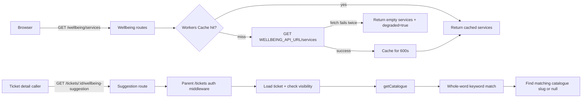

# Wellbeing Integration: service catalogue proxy and ticket suggestion

Helpdesk integrates with Team 16 Wellbeing in a read-oriented way: proxy a public catalogue through the Worker (the upstream does not provide browser CORS) and match an existing ticket’s title/description to a public catalogue service slug. The code deliberately does not link to private Wellbeing cases or appointments

## 1. Files and responsibilities

| File | Responsibility |
|---|---|
| [`backend/src/modules/wellbeing/routes.ts`](../../../../backend/src/modules/wellbeing/routes.ts:15) | public catalogue proxy/cache and protected ticket suggestion endpoint |
| [`backend/src/modules/tickets/rules.ts`](../../../../backend/src/modules/tickets/rules.ts:13) | fixed allowed wellbeing slug values and ticket type |
| [`backend/src/modules/tickets/routes.ts`](../../../../backend/src/modules/tickets/routes.ts:128) | admin PATCH validation for `wellbeing_service_slug` |
| [`backend/src/core/env.ts`](../../../../backend/src/core/env.ts:12) | `WELLBEING_API_URL` binding type |
| [`wrangler.toml`](../../../../wrangler.toml:23) | configured Wellbeing API base URL for Worker |
| [`database/schema.sql`](../../../../database/schema.sql:48) | `tickets.wellbeing_service_slug` column |
| [`database/migrations/0001_add_wellbeing_slug.sql`](../../../../database/migrations/0001_add_wellbeing_slug.sql:1) | adds stable public catalogue slug to existing DB |
| [`backend/test/ai.test.ts`](../../../../backend/test/ai.test.ts:31) | tests whole-word matching regression (`will` must not match `ill`) |

## 2. Data flow

`GET /wellbeing/services` is public and returns catalogue data; `/tickets/:id/wellbeing-suggestion` reads a specific ticket and enforces its visibility. The latter is under `/tickets`, so it receives the shared `requireAuth` middleware mounted in [`backend/src/index.ts`](../../../../backend/src/index.ts:44)

## 3. Catalogue proxy and cache

### `getCatalogue(c)`

[`getCatalogue(c)`](../../../../backend/src/modules/wellbeing/routes.ts:22) is an internal helper called by both routes:

1. Uses `caches.default` and a fixed synthetic cache key `https://internal-cache.local/wellbeing-services`.
2. Cache hit → parse cached JSON and return `{ services, degraded: false }`.
3. Cache miss → create a generated `team14-a5-<uuid>` correlation id; GET `${WELLBEING_API_URL}/services` with `X-Correlation-Id` and `AbortSignal.timeout(3000)`.
4. If the first fetch/status check fails, wait 300 ms and retry the GET once (safe to retry because it is read-only).
5. If retry also fails, return `{ services: [], degraded: true }`; this fallback is not put in cache.
6. On success, parse `{ services }`, schedule `cache.put(...)` with `executionCtx.waitUntil`, setting `Cache-Control: public, max-age=600`, then return services with `degraded: false`.

The Worker acts as a same-origin proxy, so the browser does not call Team 16 directly and does not depend on upstream CORS configuration

### Upstream assumptions and failure behavior

The successful path assumes `WELLBEING_API_URL` is configured, returns JSON with a `services` array of the declared `WellbeingService` shape, and that the JSON parses. The fetch retry `try/catch` covers fetch/non-2xx errors; the subsequent `upstream.json()` parse is outside that catch, and no runtime schema validation of `body.services` is present. Thus malformed JSON/unexpected shape is not converted to the documented empty degraded response in this implementation

The fallback handles network/timeout/status failures only. The route still responds with an empty list and `degraded: true` rather than failing the entire Helpdesk service

## 4. `matchWellbeingSlug(text)` keyword rules

The static `KEYWORDS` map has four slugs, in iteration order:

| Slug | Example keywords |
|---|---|
| `counselling` | stress/stressed, anxious/anxiety, depressed/depression, grief, lonely, mental health, counselling/counseling, panic |
| `health-clinic` | sick, ill, flu, fever, medical certificate, vaccine/vaccination, injury/injured, hurt, unwell, nurse, clinic |
| `physiotherapy` | back pain, neck pain, sports injury, sprain, physio/physiotherapy, muscle, posture |
| `wellbeing-advising` | financial hardship, sleep, homesick, settling in, work-life, study-life |

[`matchWellbeingSlug(text)`](../../../../backend/src/modules/wellbeing/routes.ts:70) iterates `Object.entries(KEYWORDS)` in declaration order. For each slug it checks whether any keyword matches a regex `\b<escaped keyword>\b` with `i` flag; first slug with a match is returned. `escapeRe()` escapes regex-special characters before interpolation. No match returns `null`.

Whole-word boundaries prevent substring false positives: for example, `will` does not contain the whole word `ill`; the regression test is in [`backend/test/ai.test.ts`](../../../../backend/test/ai.test.ts:31). This matcher is English-keyword based; it does not use an AI model, translate text, rank multiple matches, or infer a diagnosis

## 5. `GET /tickets/:id/wellbeing-suggestion`

Route flow in [`wellbeingRoutes.get(...)`](../../../../backend/src/modules/wellbeing/routes.ts:79):

1. Parse `:id` as a positive integer.
2. Load ticket through `getTicket`; if missing return 404.
3. Apply `canViewTicket`: admin can view any ticket; requester only their own; otherwise 403.
4. Fetch catalogue via `getCatalogue`.
5. If catalogue is degraded, skip keyword match and set slug to `null`; otherwise match concatenated ticket title + description.
6. Return `{ ticket_id, suggested_service, degraded }`, where service is the first catalogue entry whose `slug` equals matched slug, or `null`.

This endpoint is read-only: it does not update ticket, save the slug, create an appointment, submit a Wellbeing case, or send ticket text to Team 16. Only catalogue GET is made upstream

## 6. Stored slug vs current UI/API wiring

The schema has `tickets.wellbeing_service_slug` and backend ticket rules allow administrators to PATCH it only when `null` or one of the fixed slugs. However, a search of current `frontend/src/` finds no caller for `/wellbeing/services` or `/tickets/:id/wellbeing-suggestion`, and the frontend `api.updateTicket` field type does not include `wellbeing_service_slug`. The `Suggestion.route` type and route label include `wellbeing`, but that is AI triage routing metadata, not a call to this catalogue endpoint.

Therefore the backend catalogue/suggestion endpoints and DB field exist, but an end-user UI flow that displays the matched service or writes the selected slug was not found in the frontend source reviewed

## 7. Tests and gaps

[`backend/test/ai.test.ts`](../../../../backend/test/ai.test.ts:31) has a focused Wellbeing matcher regression test:

- `The printer will not print` → no Wellbeing slug (`will` is not `ill`).
- `I feel ill and need a medical certificate` → `health-clinic`.

No dedicated Wellbeing test file was found in the workspace inventory. The test suite does not exercise `getCatalogue` caching/retry/degraded behavior, upstream response parsing, or the HTTP endpoint with D1 access rules

## 8. Important constraints and failure cases

1. **Data minimization:** catalogue proxy fetches service data; suggestion uses local ticket title/description for keyword matching and does not send that text to Team 16.
2. **Public vs protected routes:** catalogue is public; ticket-specific suggestion requires identity and ticket visibility.
3. **Cache TTL is ten minutes:** changing the upstream catalogue may not be reflected until cached entry expires; code uses `waitUntil` for cache writes.
4. **Retry is one extra GET after 300ms:** no retry loop/backoff beyond that.
5. **Degraded result suppresses suggestion:** even if local text matches a known keyword, route returns null suggested service when catalogue cannot be retrieved.
6. **Keyword order decides ties:** text matching multiple categories returns the first slug based on object insertion order.
7. **Potential schema mismatch:** upstream JSON shape and service fields are trusted by TypeScript casts; there is no runtime validation in this module.
8. **No current frontend integration:** schema/rules/endpoints alone do not mean users can see or select the suggestion in the UI.

## 9. Scope not covered

This article does not analyze the complete reference/config module, current external Wellbeing service contract/deployment, or non-Wellbeing ticket operations. File/function progress is tracked in [`DOCUMENTATION_PROGRESS.md`](../../DOCUMENTATION_PROGRESS.md)
