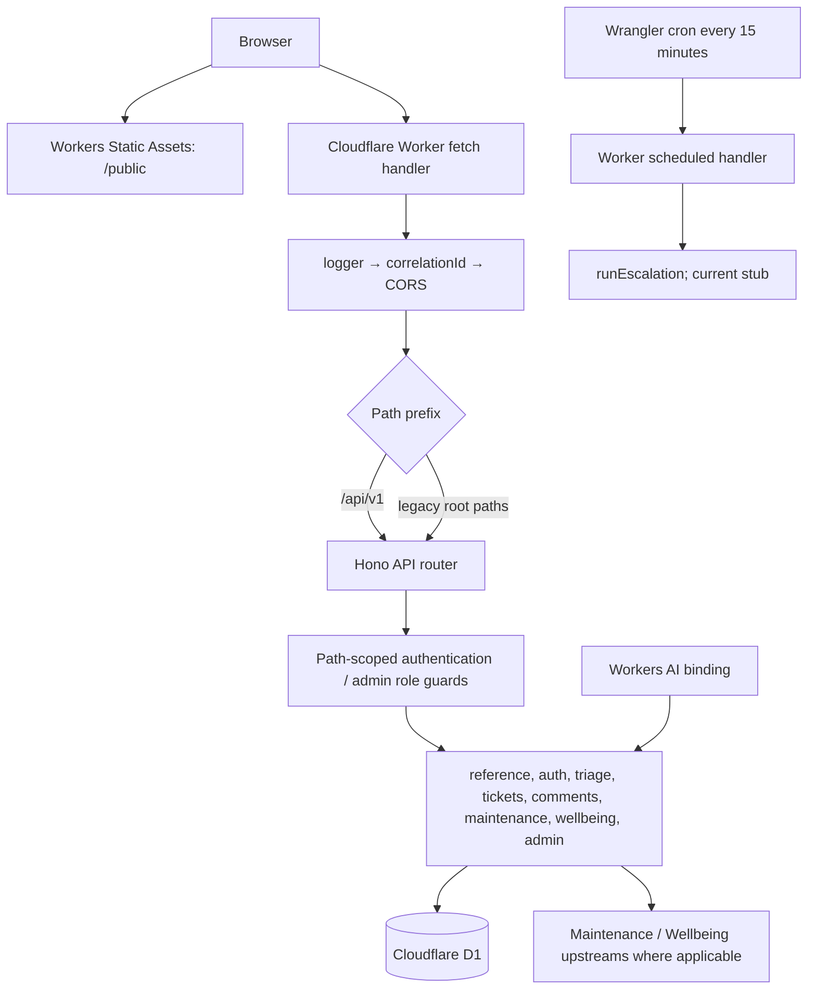

# Worker Entry Point, Middleware และ Reference Endpoints

[`backend/src/index.ts`](../../../../backend/src/index.ts:1) เป็น composition root ของ Cloudflare Worker: สร้าง API/app Hono instances, ติดตั้ง cross-cutting middleware, mount feature routers, ตั้ง 404/error handlers และ export HTTP/Cron handlers. Feature logic อยู่ใน router modules แทนที่จะอยู่ใน entrypoint

## 1. Runtime files

| File | หน้าที่ |
|---|---|
| [`backend/src/index.ts`](../../../../backend/src/index.ts:29) | API composition, middleware/auth route wiring, `fetch` และ `scheduled` handlers |
| [`backend/src/modules/reference/routes.ts`](../../../../backend/src/modules/reference/routes.ts:16) | public categories/users/config/tags/health routes |
| [`backend/src/core/config.ts`](../../../../backend/src/core/config.ts:12) | ตรวจความปลอดภัยพื้นฐานของ public Maintenance portal URL |
| [`backend/src/core/env.ts`](../../../../backend/src/core/env.ts:7) | type definitions ของ D1, AI, vars, secrets และ request context |
| [`backend/src/core/auth.ts`](../../../../backend/src/core/auth.ts:19) | `requireAuth`/`requireRole` middleware ที่ entrypoint ผูกเข้ากับ path groups |
| [`backend/src/core/http.ts`](../../../../backend/src/core/http.ts:57) | correlation ID และ central API error handling |
| [`wrangler.toml`](../../../../wrangler.toml:1) | Worker entry, static assets, AI binding, cron, vars และ D1 binding |
| [`frontend/vite.config.ts`](../../../../frontend/vite.config.ts:9) | build frontend เข้า `../public`, ซึ่ง Worker Static Assets เสิร์ฟ |

## 2. System architecture

Workers Static Assets serve built web files under `public`; [`wrangler.toml`](../../../../wrangler.toml:6) declares the assets directory. `npm run build:web` writes Vite output there. API requests are routed to Worker code (the static/API integration is configured outside the Hono route file)

## 3. `index.ts` in source order

### 3.1 Imports and module composition

`index.ts` imports Hono, CORS/logger middleware, `AppEnv`/`Bindings`, auth/error helpers, feature routers, and `runEscalation`. Routers imported include reference, auth, tickets, comments, maintenance, AI triage, admin, and wellbeing. The entrypoint comment states that new modules should be wired here while feature logic remains under `src/modules/<module>/`

### 3.2 API sub-app and service info route

`const api = new Hono<AppEnv>()` receives API routes. `api.get('/')` returns service metadata: name `helpdesk-api`, team 14, version `1.0.0`, advertised docs path `/openapi.yaml`, and health path `/api/v1/health`. The workspace inventory did not show an `openapi.yaml` file, so availability of the advertised documentation URL is unverified

### 3.3 Path-scoped authorization

Before routers mount, `api.use(...)` installs:

- `/tickets` and `/tickets/*` → `requireAuth`
- `/me` → `requireAuth`
- `/admin/*` → `requireAuth` then `requireRole('admin')`

The source comment explicitly exempts public reference endpoints and `/auth/guest`. Maintenance webhook is not behind user auth; its route validates HMAC instead. Because `/tickets/suggest` is mounted in a router under `/tickets`, it falls under the ticket auth guard

Auth middleware itself resolves demo headers to a known static/guest identity and checks role; details are in [`01-core-identity-and-auth.md`](01-core-identity-and-auth.md)

### 3.4 Router mount order

Entry order is:

1. `referenceRoutes`
2. `authRoutes`
3. `triageRoutes`
4. `ticketRoutes`
5. `commentRoutes`
6. `maintenanceRoutes`
7. `wellbeingRoutes`
8. `adminRoutes`

Source comment states `triageRoutes` must mount before `ticketRoutes` so `/tickets/suggest` is matched before generic ticket routes. All routers mount at `api.route('/', router)`; their path definitions are relative to that sub-app

### 3.5 App middleware and prefix aliases

`app = new Hono<AppEnv>()` is the outer Worker application. Middleware is registered in order:

1. `logger()`
2. `correlationId`
3. `cors(...)`

CORS allows origin `*`, methods GET/POST/PUT/PATCH/DELETE/OPTIONS and headers `Content-Type`, identity headers, correlation id, and webhook timestamp/signature. It exposes `X-Correlation-Id` to browser clients.

Then same API sub-app is mounted twice:

- `app.route('/api/v1', api)` — versioned path used by current frontend client.
- `app.route('/', api)` — legacy unprefixed paths kept for Assignment 2/Postman clients.

Thus, for example, health is available at versioned `/api/v1/health` and legacy `/health`; a request does not pass through two copies of the route, it matches the mounted path prefix it uses

### 3.6 Not-found/error handlers and Worker exports

- Unknown route → JSON 404 with `error`, `message`, and request path.
- `app.onError(handleError)` centralizes known `ApiError`/Hono exceptions and hides unhandled details from client.
- `fetch: app.fetch` is the HTTP handler.
- `scheduled` registers `runEscalation(env)` with `ctx.waitUntil`, then logs its result. The currently implemented `runEscalation` always returns `{ escalated: 0 }`; see [`06-events-and-escalation.md`](06-events-and-escalation.md)

## 4. Reference routes

Module comment labels the routes “public, no auth”; they are mounted without a `/reference` prefix

### `GET /categories[?all=true]`

[`referenceRoutes.get('/categories', ...)`](../../../../backend/src/modules/reference/routes.ts:18) reads query parameter `all`:

- exact string `true` → no active filter; returns all rows.
- otherwise → SQL adds `WHERE is_active = 1`.

Both branches select `id, name, description, is_active, created_at`, order by `id`, and return `{ count, data }`. SQL fragments are chosen from fixed source strings; values are not interpolated from query input. This endpoint is used by requester forms and admin page; `all=true` exposes disabled categories needed to re-enable them. It is public because category data is reference information and the route is not within the admin path guard

### `GET /users`

Maps `USER_DIRECTORY` in memory into `{ id, full_name, role, email }`, returns count/data. It does not query guest `user_profiles`; this route lists only static demo directory users and supports the demo `?as=<id>` picker in frontend identity restoration

### `GET /config`

Returns `{ data: { maintenance_portal_url } }`; it passes the Worker var through [`portalUrl(raw)`](../../../../backend/src/core/config.ts:12). Only trimmed `http://` or `https://` values with no whitespace are accepted; invalid/empty values become `null`. This is public UI configuration, not a secret endpoint

### `GET /tags`

Selects `{ id, name }` from `tags` ordered by id and returns count/data. Workspace frontend search did not find a `api.tags()` caller; route exists for reference clients

### `GET /health`

Runs `SELECT 1` against D1:

- success → status 200 JSON `{ status: 'ok', service: 'helpdesk', database: 'up', time }`.
- any query error → status 503 `{ status: 'degraded', service: 'helpdesk', database: 'down' }`.

The catch intentionally returns a degraded health response instead of exposing DB exception details

## 5. Wrangler bindings and deployment connection

[`wrangler.toml`](../../../../wrangler.toml:1) declares:

- `main = "backend/src/index.ts"`, compatibility date/flag.
- `assets.directory = "./public"` for generated frontend assets.
- Workers AI binding `AI`.
- cron `*/15 * * * *`.
- non-secret vars such as `ENVIRONMENT`, `WELLBEING_API_URL`, Maintenance URLs, and `EVENT_HUB_URL`.
- D1 binding `DB` and database metadata.
- secret names for Maintenance API/webhook and event-signing keys are only comments/placeholders; this documentation does not read or reproduce any values.

`backend/src/core/env.ts` types these bindings for application code. `wrangler.toml`/types say an Event Hub URL and signing secret may be provided, but [`publishEvent`](../../../../backend/src/modules/events/publish.ts:69) currently does not use them

## 6. Request examples and authorization map

| Route | Current auth boundary | Implementation note |
|---|---|---|
| `/api/v1/categories`, `/users`, `/config`, `/tags`, `/health` | Public reference routes | Data/readiness only |
| `/api/v1/auth/guest` | Public | Required to obtain a guest id |
| `/api/v1/me` | `requireAuth` | Verified demo/guest identity |
| `/api/v1/tickets/...` | `requireAuth` | Individual routes enforce role/ownership as needed |
| `/api/v1/admin/...` | `requireAuth` + admin role | Current admin endpoints return 501 |
| `/api/v1/webhooks/maintenance` | no user auth; HMAC in handler | service-to-service ingress |
| `/api/v1/` | Public | service metadata |

Legacy root alias exposes the same route handlers without `/api/v1`; authorization middleware is mounted inside the shared API sub-app, so it applies under either prefix

## 7. Tests and gaps

- [`backend/test/config.test.ts`](../../../../backend/test/config.test.ts) covers `portalUrl` acceptance/rejection only; it does not test the `/config` HTTP route.
- No dedicated reference-route tests for categories/users/tags/health were found in the current backend test inventory.
- Search found no frontend caller for `/tags` or `/health`; `/users`, `/categories`, `/config` have callers.
- The root route advertises `/openapi.yaml`, but no such file was present in the initial workspace inventory.
- CORS uses wildcard origin; it is a browser policy, not an authentication mechanism.

## 8. Scope still pending

This article documents full entrypoint/reference route wiring based on inspected source, but does not explain every feature router again. Remaining project-wide scope is in [`DOCUMENTATION_PROGRESS.md`](../../DOCUMENTATION_PROGRESS.md)
