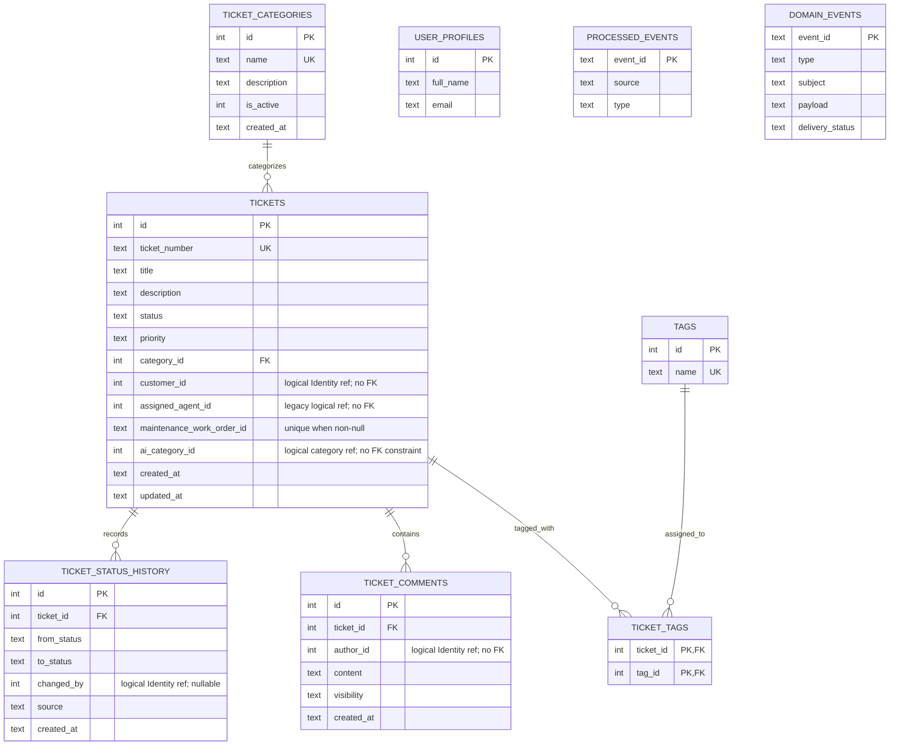

# D1 Database: schema, relationships และ migration history

เอกสารนี้อธิบายโครงสร้าง D1 จาก [`database/schema.sql`](../../../../database/schema.sql:13), การเปลี่ยนแปลงตาม migrations และ code paths ที่อ่าน/เขียนตารางเหล่านี้ แยกให้ชัดว่าตารางใดมี foreign key จริง และค่าใดเป็นเพียง logical reference ไปยัง Identity/ระบบภายนอก

## 1. ภาพรวมฐานข้อมูล

- D1 เป็นฐานข้อมูล SQLite ที่ Worker รับผ่าน binding `DB`.
- [`schema.sql`](../../../../database/schema.sql:1) เป็น **full schema สำหรับฐานข้อมูลใหม่** ไม่ใช่ไฟล์ update ของฐานข้อมูลเดิม.
- Migration files เป็น SQL ที่นำไปรันกับฐานข้อมูลที่มีอยู่แล้ว; จาก source ที่ตรวจ ไม่พบ migration ledger/table สำหรับบันทึกเลข migration ใน DB และคำสั่งใน `package.json` เรียก Wrangler execute SQL files โดยตรง.
- `PRAGMA foreign_keys = ON` ปรากฏที่ต้น schema ใหม่. ตาราง tickets, history, comments และ ticket tags มี FK ตามที่ระบุด้านล่าง.

## 2. ER Diagram — physical foreign keys กับ logical references

**Diagram interpretation:** `ticket_categories → tickets`, `tickets → history/comments`, and the two `ticket_tags` links are declared foreign keys. `customer_id`, `assigned_agent_id`, `author_id`, `changed_by`, `ai_category_id`, `maintenance_work_order_id`, and event `subject` do not have a corresponding FK in this schema. Although `ai_category_id` semantically points to a category, there is no declared FK for it.

`user_profiles.id` is also not connected by a physical FK to ticket requester ids: the comments explicitly describe user references as owned by Identity or the stub. Code uses `findIdentity()`/`displayNames()` to resolve guest identities and names at runtime.

## 3. ตารางทีละกลุ่ม

### 3.1 `ticket_categories`

ประกาศใน [`schema.sql`](../../../../database/schema.sql:18):

- `id`: integer primary key autoincrement.
- `name`: required, unique.
- `description`: optional text.
- `is_active`: integer default `1`, `CHECK` จำกัด `0` หรือ `1`.
- `created_at`: default SQLite `datetime('now')`.

`tickets.category_id` อ้าง FK มาที่ตารางนี้. Route ใช้ `categoryIsActive()` ก่อน create หรือเปลี่ยน category; query reference categories ปกติเลือกเฉพาะ active.

### 3.2 `tickets`

เป็น current state ของ ticket:

- Primary id `id`; public-facing reference `ticket_number` เป็น required และ unique.
- `title`/`description` เก็บข้อความปัญหา. `title` เป็นชื่อเดิมจาก Assignment 2 ซึ่งมีความหมายตรงกับ PRD `subject`.
- `status` default `open`; schema `CHECK` ยังรับ `assigned` พร้อม `open`, `in_progress`, `resolved`, `closed` เพื่อรองรับ legacy rows.
- `priority` default `medium`, check ด้วย `low`, `medium`, `high`, `urgent`.
- `category_id` required FK ไป category; `customer_id` required แต่เป็น logical Identity id ไม่ใช่ FK; `assigned_agent_id` เป็น legacy field.
- `resolution_note`, `resolved_at`, `created_at`, `updated_at` รองรับผลและเวลา.
- Integration fields: `wellbeing_service_slug`; `maintenance_work_order_id`, `maintenance_status`, `maintenance_status_at`; `escalated_at`.
- AI fields: `ai_category_id`, `ai_priority`, `ai_route`, `ai_source`; เป็นคำแนะนำ ไม่ใช่ category/priority/status จริงของ ticket.

Indexes:

- `idx_tickets_status`, `idx_tickets_customer`, `idx_tickets_agent`, `idx_tickets_category` ช่วยค้นตามคอลัมน์เหล่านั้น.
- `idx_tickets_queue(status, priority, created_at)` รองรับ queue query; ลำดับ urgency จริงถูกกำหนดใน SQL expression จาก repository.
- `idx_tickets_work_order` เป็น unique partial index เฉพาะ rows ที่ `maintenance_work_order_id IS NOT NULL`, ป้องกัน work order เดียวถูก link ให้หลาย ticket แต่ยังอนุญาตหลาย `NULL`.

### 3.3 `ticket_status_history`

เก็บประวัติการเปลี่ยนสถานะเป็น append rows:

- `ticket_id` FK ไป ticket พร้อม `ON DELETE CASCADE`.
- `from_status` nullable (เช่นแถวสร้าง ticket ใช้ `NULL`), `to_status` required.
- `changed_by` nullable logical Identity id; comment ระบุ `NULL` ใช้กับ system/Maintenance.
- `source` default `helpdesk` และมีค่าตาม code convention เช่น `helpdesk`, `maintenance`, `system`; schema ไม่มี `CHECK` จำกัด enum นี้.
- `note`, `created_at` เป็นข้อมูลเสริม.

`idx_history_ticket(ticket_id, created_at)` รองรับ detail query. Repository เพิ่ม `id` เป็น tie-breaker ใน `ORDER BY created_at, id`.

### 3.4 `ticket_comments`

ใช้เก็บบทสนทนาและ automatic system messages:

- `ticket_id` FK cascade; `author_id` เป็น logical Identity ID (system message ใช้ id `0` ตาม comments module).
- `content` required; `visibility` default `public` และ `CHECK` ปัจจุบันยังรับ `public`/`internal`.
- `created_at` default now; index `idx_comments_ticket(ticket_id, created_at)`.

Migration 0004 ลบแถว internal ที่มีอยู่ แต่คง column และ CHECK ไว้เพราะ SQLite จัดการ drop CHECK-constrained column ไม่สะดวก; code รุ่นปัจจุบันเขียน comment ปกติเป็น public และ system message เป็นแถวเดียวกัน.

### 3.5 `user_profiles`

เก็บ profile ของ guest ที่ผู้ใช้ประกาศเอง: `id` เป็น primary key (ไม่ได้ประกาศ `AUTOINCREMENT`), `full_name` required, `email` optional, `created_at`/`updated_at` มี default. Guest ID เริ่มจาก 1000 ตาม logic ใน profiles module. Static demo users ไม่ได้เก็บในตารางนี้.

### 3.6 Events และ tags

- `processed_events`: primary key `event_id`, `source`, `type`, `received_at`; ใช้จำ inbound webhook events ที่ประมวลผลแล้ว. Source ของ Maintenance route อ้างตารางนี้เพื่อ deduplicate event id.
- `domain_events`: outbox-shaped table มี `event_id` PK, `type`, `subject`, JSON-text `payload`, `delivery_status`, `attempts`, timestamps. Check จำกัดสถานะเป็น `pending`, `delivered`, `failed`, `skipped`; index ตาม delivery status/time. **ตารางมีอยู่แต่ publisher ที่ตรวจแล้วปัจจุบันยังไม่ insert/ส่ง event.**
- `tags`: tag directory, unique name.
- `ticket_tags`: junction table many-to-many; composite primary key `(ticket_id, tag_id)`, FK ทั้งสองด้านและ cascade delete.

### 3.7 Seed data

`INSERT OR IGNORE` ใส่ categories ID 1–5: Network, Hardware, Software, Account, Facility และ tags ID 1–5: urgent, bug, hardware, software, network. `OR IGNORE` ทำให้การรัน schema ซ้ำไม่ insert duplicate ที่ชน unique/primary key; ไม่ได้อัปเดต description ของแถวที่มีอยู่แล้ว

## 4. ประวัติ migrations ตามลำดับไฟล์

### `0001_add_wellbeing_slug.sql`

เพิ่ม `tickets.wellbeing_service_slug TEXT`. เป็น stable public catalogue slug เท่านั้น; comment ระบุเจตนาไม่เก็บ Wellbeing private case/appointment/record identifiers.

### `0002_final_features.sql`

ระบุว่าใช้กับ database เดิมที่มี Assignment 2 schema และ migration 0001 แล้ว; schema ใหม่ใช้ `schema.sql` แทน. เพิ่ม:

1. `ticket_categories.is_active` default 1.
2. Maintenance work-order id/status/timestamp columns.
3. `tickets.escalated_at`.
4. `ai_category_id`, `ai_priority`, `ai_route`, `ai_source`.
5. Queue index และ unique non-null work-order index.
6. `ticket_status_history`/index, `ticket_comments`/index, `processed_events`, `domain_events`/index.

Migration นี้สมมติว่าตารางหลัก (`tickets`, `ticket_categories`, tags ฯลฯ) มีอยู่แล้ว; ไม่ใช่ bootstrap จาก database ว่าง

### `0003_drop_assigned_status.sql`

PRD รุ่นใหม่ไม่มี agent role/status `assigned`. SQLite ไม่ได้แก้ CHECK constraint ในที่เดิมตาม comment ของ migration; migration จึงทำ data conversion:

1. เพิ่ม history row สำหรับ ticket ที่ยังเป็น `assigned`: from `assigned`, to `in_progress`, actor `NULL`, source `system`, note อธิบายการย้าย.
2. update ticket เหล่านั้นเป็น `in_progress` และ bump `updated_at`.

CHECK constraint ที่เก็บใน schema รุ่นนี้ยังรับ `assigned`; API enum ไม่เขียนค่านั้นแล้ว และ frontend มี compatibility mapping เป็น `in_progress`.

### `0004_guest_profiles.sql`

1. `CREATE TABLE IF NOT EXISTS user_profiles` สำหรับ guest profiles.
2. `DELETE FROM ticket_comments WHERE visibility = 'internal'` เพื่อล้าง internal notes ตาม PRD v1.1.
3. คง `visibility` column/CHECK ไว้ ไม่ได้ drop schema column.

**ข้อควรระวัง:** production command comment ระบุว่าการรัน migration นี้ลบ internal notes ที่มีอยู่; ต้องได้รับอนุมัติตาม project instructions ก่อนรัน migration ใด ๆ ที่แตะ production. ในงานนี้ไม่มีการรัน SQL หรือแก้ database.

## 5. Fresh database เทียบกับ existing database

จาก [`package.json`](../../../../package.json:15):

| Script | SQL ที่รัน | เจตนาตาม source |
|---|---|---|
| `db:local:fresh` | `database/schema.sql` บน local D1 | สร้าง schema ใหม่เต็มชุดพร้อม seeds |
| `db:local:migrate` / `db:remote:migrate` | `0002_final_features.sql` | เพิ่ม final features ให้ฐานเดิมที่มี Assignment 2 + 0001 แล้ว |
| `db:local:update` / `db:remote:update` | `0003_drop_assigned_status.sql` แล้ว `0004_guest_profiles.sql` | แปลง status เก่า, เพิ่ม profiles, ลบ internal comments เก่า |

ไฟล์ `0001` มีคำสั่งตัวอย่างใน comment แต่ manifest ที่ตรวจไม่มี npm script แยกสำหรับมัน; existing DB ต้องมี migration นี้แล้วก่อนรัน 0002 ตาม precondition ใน 0002. `ALTER TABLE ... ADD COLUMN` ใน 0001/0002 ไม่ได้ใช้ `IF NOT EXISTS`; อย่ารันซ้ำโดยสมมติว่า idempotent. ตรวจ migration history/DB ก่อน apply.

อย่ารัน `schema.sql` ทับ existing production database: header ระบุให้ใช้ migrations. อย่ารัน [`clean-demo-data.sql`](../../../../database/clean-demo-data.sql:1) โดยไม่ตรวจผลและขออนุมัติตามเงื่อนไขของทีม เพราะมันลบข้อมูล.

## 6. Demo data cleanup script

[`database/clean-demo-data.sql`](../../../../database/clean-demo-data.sql:17) ไม่ได้ผูกกับ npm script และ header ระบุชัดว่า destructive. มัน:

1. ลบ `domain_events` ที่ subject ตรงกับ tickets ของ demo customer ids 1, 2, 6.
2. ลบ comments, status history และ ticket tag links ของ tickets เหล่านั้นก่อน.
3. ลบ tickets ของ ids 1, 2, 6.
4. ลบทุก `processed_events` row (รวม mock webhook dedupe ids).
5. คง categories, tags, admin, guest profiles และ tickets ของ guest users (id 1000+) ไว้.

Comment แนะนำให้ query จำนวน tickets ก่อน และ export backup ก่อน remote run; ticket ที่ linked กับ Team 10 work order ก็ถูกลบ จึงต้องแจ้งระบบคู่เชื่อมต่อ. Script ลบ child rows ด้วยตนเอง แม้ schema มีบาง `ON DELETE CASCADE`; อย่าคาดเดาว่าการรันจะปลอดภัยโดยไม่อ่านเงื่อนไข customer ids ก่อน

## 7. ตัวอย่างเชื่อม schema กับ request code

### สร้าง ticket

`POST /tickets` เรียก `insertTicket`, ซึ่ง INSERT `tickets` fields: ticket number, title, description, priority, category id, customer id. จากนั้น route เรียก `recordStatus`, ที่ INSERT history `from_status=NULL` → `open`. Detail query join categories เพื่อได้ `category_name`; customer display name ถูก lookup ผ่าน profile/directory code ไม่ได้ FK join.

### เปลี่ยน status

PATCH/resolve handlers update current row ใน `tickets` และเรียก `recordStatus` แยกเพื่อเพิ่ม event history. `ticket_status_history` จึงเป็น log rows ไม่ใช่ source สำหรับ current status (current status อยู่ `tickets.status`).

### Delete

Delete route ลบ parent `tickets` row; history/comments/ticket_tags มี cascade declarations. Cleanup SQL กลับไปลบ child records explicitly. `domain_events.subject`/`processed_events` ไม่มี FK, cleanup script จึงต้อง handle event rows explicitly.

### AI suggestion

`recordSuggestion` update `ai_*` columns ใน ticket row; `ai_category_id` ไม่มี FK constraint. `ai_category_name` ถูกเติมด้วย left join ใน ticket repository.

## 8. แนวคิด/สิ่งที่ควรระวัง

1. **Foreign key vs logical reference:** อย่าสมมติว่า requester/author ids ถูก database ตรวจว่ามี identity; validation อยู่ใน application layer.
2. **Current state vs history:** `tickets.status` คือค่าปัจจุบัน; history เป็น timeline เพิ่มแถว.
3. **Legacy `assigned`:** schema CHECK ยังรับ แต่ backend rules/UI ไม่ใช้เป็นสถานะปกติ; migration 0003 แปลง rows เก่า.
4. **`visibility` legacy:** internal comments ถูกลบโดย migration 0004 แต่ schema column/constraint ยังคงอยู่.
5. **`domain_events` กับ implementation:** มี outbox table ไม่ได้แปลว่า publisher ใช้งานแล้ว; publisher source ปัจจุบัน log-only.
6. **Unique partial index:** work order id ต้องไม่ซ้ำเมื่อไม่ null; maintenance link logic ต้อง handle conflict.
7. **Migrations ไม่ใช่ all-idempotent:** 0001/0002 ใช้ ALTER ADD COLUMN โดยไม่มี guard; apply ซ้ำอาจ fail.
8. **Cleanup script destructive:** scope มี exact ids และ globally clears `processed_events`; production run irreversible per comment.
9. **Schema snapshot vs migration path:** fresh schema មាន latest set รวมกัน; migrations แสดงลำดับ upgrade ของ existing DB. อย่าเอา schema snapshot ไปแทน upgrade script โดยไม่วางแผน.

## 9. ยังไม่ครอบคลุม

บทนี้อธิบาย schema และ SQL migration files ที่ตรวจแล้ว แต่ยังไม่รันตรวจ introspection กับ local/remote D1 และไม่ตรวจข้อมูลจริงใน database. รายละเอียดว่าแต่ละ route/integration ใช้ tables อย่างไรนอก ticket/auth/AI ที่อ้างไว้ จะทยอยเพิ่มตาม module analysis. สถานะรายไฟล์อยู่ใน [`DOCUMENTATION_PROGRESS.md`](../../DOCUMENTATION_PROGRESS.md)
