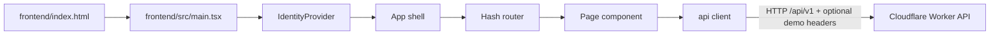

# Frontend Foundation: startup, routing, identity และ API client

เอกสารนี้อธิบายเส้นทางเริ่มทำงานของเว็บตั้งแต่ HTML โหลด React ไปจนถึงการเลือกหน้า การจำผู้ใช้แบบ demo และการส่ง request ไป API อธิบายเฉพาะไฟล์ที่ตรวจแล้ว ไม่ครอบคลุม business logic ของแต่ละหน้า เช่น การสร้าง ticket หรือ dashboard

## 1. ภาพรวมและขอบเขต

Frontend เป็น React 18 + TypeScript ที่ build ด้วย Vite แล้วให้ Cloudflare Worker เสิร์ฟ static assets การนำทางใช้ URL hash (`#/...`) แทน router library ส่วนการติดต่อ backend รวมไว้ที่ [`frontend/src/api/client.ts`](../../../../frontend/src/api/client.ts:1)



ปลายทาง Worker ใน diagram เป็นขอบเขตเชื่อมต่อที่ client ใช้จริง (`/api/v1`) ส่วน middleware, routes และการทำงานฝั่ง server จะอธิบายในเอกสาร backend แยกต่างหาก

## 2. ไฟล์ที่เกี่ยวข้องและความสัมพันธ์

| ไฟล์ | หน้าที่ | เรียกใช้/ถูกใช้โดย |
|---|---|---|
| [`frontend/index.html`](../../../../frontend/index.html:17) | มี `#root` และโหลด entry module | Vite build/dev server หรือ static asset host |
| [`frontend/src/main.tsx`](../../../../frontend/src/main.tsx:1) | สร้าง React root, ครอบ provider และโหลด CSS | เริ่มจาก script ใน HTML |
| [`frontend/src/App.tsx`](../../../../frontend/src/App.tsx:30) | เลือกหน้า, ปรับเมนูตาม role และบังคับ route ที่แต่ละ role เข้าได้ | ถูก mount ใน `main.tsx` |
| [`frontend/src/auth/identity.tsx`](../../../../frontend/src/auth/identity.tsx:69) | เก็บ user/session และเปิด identity context ให้ component | ใช้โดย `App`, `Login` และหน้าอื่นผ่าน `useIdentity()` |
| [`frontend/src/pages/Login.tsx`](../../../../frontend/src/pages/Login.tsx:13) | UI สำหรับ requester/admin demo sign-in | ถูกเลือกโดย `App` เมื่อยังไม่มี user หรือเข้า staff sign-in |
| [`frontend/src/lib/router.ts`](../../../../frontend/src/lib/router.ts:1) | อ่าน hash, subscribe ต่อ `hashchange`, เปลี่ยน route และ match parameter | ใช้โดย `App`, `Login` และส่วน UI ที่เปลี่ยนหน้า |
| [`frontend/src/lib/usePersisted.ts`](../../../../frontend/src/lib/usePersisted.ts:4) | React state แบบ boolean ที่พยายามจำใน `localStorage` | `App` ใช้จำสถานะยุบ/ขยาย sidebar |
| [`frontend/src/api/client.ts`](../../../../frontend/src/api/client.ts:1) | สร้าง request, ใส่ header และแปลง response/error | page และ service เรียกผ่าน object `api` |
| [`frontend/src/api/types.ts`](../../../../frontend/src/api/types.ts:1) | TypeScript shapes สำหรับข้อมูล API ที่ UI ใช้ | API client และ component/page |
| [`frontend/vite.config.ts`](../../../../frontend/vite.config.ts:1) | ตั้งค่า Vite, React plugin, output directory และ dev proxy | ใช้โดยคำสั่ง Vite ใน root `package.json` |

### ลำดับ dependency แบบย่อ

`index.html` → `main.tsx` → `IdentityProvider` → `App` → `Login`/page → `api` ใน client

`App` และ `Login` ยังใช้ router utilities (`usePath`, `navigate`, `match`) ส่วน `App` ใช้ `usePersisted` และ `api` นำ type จาก `types.ts` มาอธิบายค่าที่รับ/ส่ง

## 3. เริ่มทำงานของหน้าเว็บ

### 3.1 HTML เป็น host

ใน [`frontend/index.html`](../../../../frontend/index.html:17) มี `<div id="root"></div>` เป็นตำแหน่งให้ React วาด UI และ script `type="module"` โหลด `/src/main.tsx` (บรรทัด 18–19) ไม่มี UI หลักฝังอยู่ใน HTML

### 3.2 React root และ provider

Excerpt จาก [`frontend/src/main.tsx`](../../../../frontend/src/main.tsx:7):

```tsx
createRoot(document.getElementById('root')!).render(
  <StrictMode>
    <IdentityProvider>
      <App />
    </IdentityProvider>
  </StrictMode>,
);
```

- `createRoot(...)` สร้าง React root บน DOM node ที่มี id `root`; `!` เป็น TypeScript non-null assertion ซึ่งบอก compiler ว่าคาดว่าจะพบ element นี้
- `StrictMode` เปิดการตรวจเชิงพัฒนาเพิ่มเติมของ React; ไม่ใช่ wrapper ที่เก็บ business state
- `IdentityProvider` อยู่เหนือ `App` เพื่อให้ `App` และลูกเรียก `useIdentity()` ได้
- CSS จาก `./styles/app.css` ถูก import ใน entry module เดียวกัน

### 3.3 Vite build และ dev server

[`frontend/vite.config.ts`](../../../../frontend/vite.config.ts:9) กำหนด `root` เป็น directory ของ frontend, ใช้ React plugin, build output ไป `../public` และให้ dev server ฟัง port `5173` โดย proxy path `/api` ไป `http://127.0.0.1:8787` (บรรทัด 9–13) นี่ทำให้ frontend dev server ส่ง API request ไป Wrangler dev server ได้ โดย URL ใน client ยังคงเป็น relative path `/api/v1/...`

## 4. Routing และการเลือกหน้าตาม role

### 4.1 Router แบบ hash

[`frontend/src/lib/router.ts`](../../../../frontend/src/lib/router.ts:6) ใช้ browser `hashchange` เป็น event source:

```ts
const subscribe = (cb: () => void) => {
  window.addEventListener('hashchange', cb);
  return () => window.removeEventListener('hashchange', cb);
};
const getPath = () => window.location.hash.replace(/^#/, '') || '/';
```

- `subscribe` เพิ่ม listener และคืน cleanup function เพื่อถอด listener เมื่อไม่ต้อง subscribe แล้ว
- `getPath` เอา `#` นำหน้าออก และใช้ `/` เมื่อ hash ว่าง
- `usePath()` ใช้ React `useSyncExternalStore(subscribe, getPath, () => '/')` ให้ React subscribe ค่า location ภายนอก state ของ React
- `navigate(path)` ตั้ง `window.location.hash`; browser จะสร้าง `hashchange` event ให้ subscribers
- `match(pattern, path)` แยกทั้งสอง path เป็น segments ด้วย `/`; ถ้าจำนวน segments ต่างกันจะคืน `null`; segment ที่ pattern ขึ้นต้น `:` จะถูกอ่านเป็น parameter และ decode ด้วย `decodeURIComponent`

ตัวอย่างจากรูปแบบที่ source ระบุ: `match('/my/:id', '/my/12')` คืน `{ id: '12' }`; ถ้า path เป็น `/my/12/comments` จำนวน segment ไม่ตรงและคืน `null`

### 4.2 Route mapping ใน App

ใน [`frontend/src/App.tsx`](../../../../frontend/src/App.tsx:30) `App()` อ่าน `user`, `ready`, `signOut`, `error` จาก identity context และอ่าน `path` จาก `usePath()` จากนั้นคำนวณ `staff = isStaff(user)`

`useEffect` ที่บรรทัด 36–43 ปรับ route หลัง user เปลี่ยน:

- ถ้ายังไม่มี user ไม่ทำ redirect
- path `/` หรือ `/staff` จะพา admin ไป `/queue` และ customer ไป `/new`
- admin ที่เปิด `/new`, `/profile` หรือ path ขึ้นต้น `/my` จะถูกส่ง `/queue`
- customer ที่เปิด path ขึ้นต้น `/queue` หรือ `/admin` จะถูกส่ง `/my`

หลังจากนั้น `nav` ถูกสร้างตาม role และ `page` ถูกเลือกจาก path เช่น `/new` → `CreateTicket`, `/my/:id` → `MyTickets` พร้อม `selectedId`, `/queue/:id` → `Dashboard`, `/chat/:id` → `Messages` (บรรทัด 45–68) การเลือก component เป็นเงื่อนไขใน `App` ไม่ได้ใช้ route configuration library

หาก user โหลดสำเร็จ `App` render `<div key={path} className="route">{page}</div>` (บรรทัด 149–152) การเปลี่ยน `key` ตาม path ทำให้ React ถือ route ที่เปลี่ยนเป็น subtree คนละตัวและ mount หน้าใหม่

### 4.3 สถานะ login และ loading

- เมื่อ `ready && !user && !error` `App` แสดง `<Login />` (บรรทัด 76–85)
- ถ้ามี `error` จะแสดง “Cannot connect to the system” พร้อม error text (บรรทัด 142–148)
- ระหว่างรอ identity และไม่มี user/error จะแสดง `Loading` (บรรทัด 153–155)
- หลังรู้ user แล้วจึง mount หน้า เพื่อให้ request แรกจากหน้านั้นส่ง identity headers ได้ (เหตุผลที่ source comment ไว้บรรทัด 150–151)

## 5. Demo identity และ session state

> นี่คือ identity stub สำหรับ demo ไม่ใช่ระบบยืนยันตัวตนจริง ไม่มี password, token หรือการตรวจว่าผู้กรอกชื่อเป็นบุคคลนั้นจริง Source ระบุข้อจำกัดนี้ไว้ใน [`frontend/src/auth/identity.tsx`](../../../../frontend/src/auth/identity.tsx:1) และ [`frontend/src/pages/Login.tsx`](../../../../frontend/src/pages/Login.tsx:1)

### 5.1 ข้อมูลที่จำและตำแหน่งจัดเก็บ

ใน `identity.tsx` มี storage keys 2 ตัว:

- `SESSION_KEY = 'helpdesk.session'` เขียนใน `sessionStorage` เก็บ `{ id, role }` สำหรับ tab ปัจจุบัน
- `GUEST_KEY = 'helpdesk.guest'` เขียนใน `localStorage` เก็บ profile ผู้ guest เพื่อกลับมา sign in ใน browser เดิม

ฟังก์ชัน `read(storage, key)` parse JSON และคืน `null` เมื่อไม่มีค่า/อ่านไม่ได้/parse ไม่สำเร็จ ส่วน `write(storage, key, value)` ลบ key เมื่อ `value == null`; ไม่เช่นนั้น serialize เป็น JSON ทั้งสองฟังก์ชันจับ storage exceptions เพื่อให้ app ใช้งานต่อได้ในกรณี storage ใช้ไม่ได้

`IdentityProvider` เก็บ React state ได้แก่ `user`, `savedGuest`, `ready` และ `error`; context type `IdentityState` ยังเปิด actions สำหรับ sign in, update profile และ sign out ให้ component ลูก

### 5.2 Restore session ตอนเริ่ม

`useEffect` ใน `IdentityProvider` ทำงานเมื่อ mount:

1. ตั้งตัวแปร `alive = true` เพื่อป้องกัน set state หลัง component unmount
2. เรียก `sessionFromUrl()` ก่อน; ถ้าไม่มี session จาก URL จึงอ่าน `sessionStorage`
3. `sessionFromUrl()` รองรับ `?as=<id>` สำหรับ demo: id ที่เป็น integer บวกและมากกว่าหรือเท่ากับ 1000 ถูกถือเป็น customer; id ต่ำกว่านั้นค้นใน `api.users()` เพื่ออ่าน role จาก directory response
4. ถ้าพบ session จะเรียก `setApiUser(session)` ก่อน `api.me()` เพื่อให้ request `/me` มี headers แล้วค่อยวางข้อมูลผู้ใช้ที่ server ส่งกลับใน React state
5. ถ้าเกิด exception จะล้าง API user และ session; เฉพาะ `ApiError` status `0` (network failure ตาม client) ถูกบันทึกเป็น `error`
6. ใน `finally` ตั้ง `ready = true` หาก component ยัง mount อยู่

URL demo ถูกให้สิทธิ์เหนือ session ที่จำไว้ เพราะใช้ `sessionFromUrl() ?? read(...)`

### 5.3 Sign in และ sign out

- **Requester:** `Login` เรียก `signInGuest(name.trim(), email.trim())`; identity provider เรียก `api.createGuest`, บันทึก guest ที่ตอบกลับไว้ใน local storage แล้วเรียก `enter(created)` เพื่อเซ็ต API user, session storage และ React user
- **กลับมาเป็น guest เดิม:** `continueAsSavedGuest()` ตั้ง API user จาก saved id แล้วเรียก `api.me()`. หาก request offline (`status === 0`) จะรักษา saved profile ไว้และโยน error กลับ; ถ้า server ไม่รู้จัก id แล้ว จะลบ saved guest และคืน `false` เพื่อให้หน้า login เปิด form
- **Admin demo:** `signInStaff()` ใช้ `STAFF_ID = 5`, role `admin`; ตั้ง API user ก่อนเรียก `api.me()` และล้าง API user เมื่อ call ล้มเหลว
- **แก้ profile:** `updateProfile()` เรียก API แล้วอัปเดต React state และข้อมูล guest ที่จำใน local storage
- **Sign out:** `signOut()` ล้าง API user, React user และ session storage แต่ไม่ลบ saved guest; เอา query string ออกจาก URL หากมี แล้วตั้ง hash เป็น `/`

ใน [`frontend/src/pages/Login.tsx`](../../../../frontend/src/pages/Login.tsx:23) ฟังก์ชัน `run(action)` คุม `busy`, ล้าง error เดิม, เรียก action, จับ `ApiError.fields` ไปแสดงราย field และ reset `busy` ใน `finally`. `start()` ลองกลับเข้า saved guest ก่อน ถ้าไม่มีหรือใช้ไม่ได้จะเปลี่ยน UI ไป form; `submit(e)` ป้องกัน form reload แล้วเรียก `signInGuest` ด้วย input ที่ trim แล้ว

## 6. API client และ data contract

### 6.1 `request<T>`: จุดกลางของ HTTP

[`frontend/src/api/client.ts`](../../../../frontend/src/api/client.ts:33) กำหนด `BASE = '/api/v1'` และตัวแปร module-level `currentUser`. `setApiUser(user)` ถูกเรียกโดย identity provider เมื่อ demo user เปลี่ยน

ลำดับใน `request<T>(path, init)`:

1. สร้าง `Headers` จาก `init.headers`
2. ถ้ามี `init.body` ตั้ง `Content-Type: application/json`
3. ถ้ามี `currentUser` ใส่ `x-user-id` และ `x-user-role`
4. เรียก `fetch(BASE + path, { ...init, headers })`
5. ถ้า `fetch` throw ให้แปลงเป็น `ApiError(0, 'Network', ...)`
6. พยายาม parse JSON; ถ้าทำไม่ได้ใช้ `{}`
7. ถ้า `res.ok` คืน body เป็น generic type `T`; status 501 กลายเป็น `NotReadyError`; status อื่นที่ไม่สำเร็จกลายเป็น `ApiError` ที่เก็บ status, error code, message และ field errors

`T` เป็น type assertion เพื่อความสะดวก compile-time ไม่ได้ validate JSON runtime ด้วย schema validator ในโค้ดส่วนนี้

### 6.2 Typed errors

- `ApiError` ขยาย `Error` และเก็บ `status`, `code`, และ `fields?`
- `NotReadyError` ขยาย `ApiError` เพิ่ม `feature` และ `owner`; ใช้สำหรับ HTTP 501
- `Login` ใช้ `instanceof ApiError` เพื่อแสดง field errors; `IdentityProvider` ใช้ status `0` แยก network failure จาก identity ที่ server ไม่พบ

### 6.3 Helper และ API surface

- `post(body)` และ `patch(body)` serialize object เป็น JSON string พร้อม HTTP method ที่ตรงกัน
- `fix(ticket)` แปลง status เก่า `assigned` เป็น `in_progress` ที่ฝั่ง UI โดยไม่แก้ข้อมูล backend/database; helper ถูกใช้กับผล ticket และรายการ ticket
- object `api` จัดกลุ่ม functions ตามงาน: identity (`me`, `createGuest`, `updateProfile`), reference (`config`, `users`, `categories`), tickets, comments, maintenance, triage และ admin
- response ที่ API client คาดไว้มี wrapper เช่น `{ data: User }`; method ส่วนใหญ่แกะ `.data` ให้หน้าเรียกได้ง่าย

ข้อมูล type ที่ใช้ร่วมกันอยู่ใน [`frontend/src/api/types.ts`](../../../../frontend/src/api/types.ts:3): role มี `customer | admin`; ticket status ฝั่ง UI มี `open | in_progress | resolved | closed`; `Ticket`, `TicketDetail`, `Comment`, `Suggestion` และ `Stats` ระบุ shapes ที่หน้าจอคาดหวัง

## 7. ตัวอย่างการทำงานจริง: requester เข้าครั้งแรก

สมมติเปิด root URL โดยไม่มี hash, ไม่มี session และไม่มี saved guest แล้วกรอกชื่อ `Mali` กับ email `mali@example.test`:

1. Browser ใส่ `#root` จาก [`frontend/index.html`](../../../../frontend/index.html:18) แล้วโหลด `main.tsx`.
2. `IdentityProvider` mount; อ่าน `?as` และ `sessionStorage` ไม่พบ session; `finally` ตั้ง `ready = true`.
3. `App` เห็น `ready` แต่ไม่มี `user/error` จึง render `Login`.
4. `Login.submit` ป้องกัน native form submit แล้ว trim ค่าเป็น `Mali` และ `mali@example.test`; `run` ตั้ง `busy = true`.
5. `signInGuest` เรียก `api.createGuest`; client ส่ง `POST /api/v1/auth/guest` พร้อม JSON body `{ "name": "Mali", "email": "mali@example.test" }`. ช่วงนี้ยังไม่มี `currentUser` จึงไม่ใส่ identity headers.
6. เมื่อ response สำเร็จ client อ่าน `{ data: User }` แล้ว `createGuest` คืน `User`.
7. Provider บันทึก user ใน `localStorage` เป็น saved guest แล้ว `enter` เซ็ต `currentUser`, เขียน `{ id, role }` ลง session storage และอัปเดต React `user`.
8. `App` render shell สำหรับ customer; effect พบ root path `/` จึงเปลี่ยนเป็น `#/new`. การเปลี่ยน hash ทำให้ `usePath()` แจ้ง React และ `App` เลือกหน้า `CreateTicket`.
9. Request จากหน้าหลังจากนี้จะถูก `request()` เติม `x-user-id` และ `x-user-role`, เพราะ `currentUser` ถูกตั้งก่อนหน้า mount ของ page.

ID/role ที่ตอบกลับ, server-side validation, D1 insert และ exact response body มาจาก backend implementation และจะยืนยันในบท backend/auth; ตัวอย่างนี้อธิบายเฉพาะ input/output contract ที่ frontend ระบุไว้ ไม่สมมติรายละเอียด database operation

## 8. แนวคิดสำคัญและสิ่งที่อาจทำให้พัง

1. **Provider ต้องครอบ component ที่เรียก hook:** หากย้าย `App` ออกนอก `IdentityProvider`, `useIdentity()` จะ throw error ตาม guard ในบรรทัด 162–165 ของ identity module.
2. **ตั้ง API user ก่อน protected request:** ลำดับ `setApiUser()` → `api.me()` สำคัญต่อการแนบ headers; ลบหรือสลับลำดับอาจทำให้ restore session ไม่ผ่าน backend auth.
3. **Client-side role routing ไม่ใช่ security boundary:** การซ่อนหน้า/redirect ช่วย navigation แต่ server ต้องบังคับ auth/role ด้วยตัวเอง; header demo เป็นข้อมูลที่ browser ส่งได้ ไม่ใช่ credential ลับ.
4. **Hash route ต้องไม่สับสนกับ query string:** `?as=...` อยู่ใน `window.location.search`; page route อยู่ใน `window.location.hash`.
5. **API response shape ต้อง sync:** ถ้า backend เปลี่ยน wrapper `{ data: ... }`, enum หรือชื่อ field โดยไม่ปรับ `api`/`types.ts` UI อาจอ่าน `undefined` หรือ type ที่คอมไพล์ผ่านแต่ runtime ไม่ตรง.
6. **สถานะ `assigned`:** API type ไม่ประกาศ status นี้ แต่ client มี compatibility conversion; การเอา `fix()` ออกอาจทำให้ status เก่าจัดการไม่ครบใน UI.
7. **storage เป็นเพียงการจำค่า demo:** `sessionStorage` หมดอายุเมื่อปิด tab; `localStorage` ช่วยจำ guest profile ใน browser เดิม แต่ไม่ได้สร้าง account ที่ยืนยันตัวตนได้และไม่ได้ sync ข้ามอุปกรณ์.
8. **`?as=<id>` เป็นทางเข้าทดสอบ:** อย่ามอง query parameter นี้เป็น production login mechanism.

## 9. ไฟล์ frontend ที่ยังไม่ได้อธิบาย

เอกสารนี้ยังไม่อธิบายรายละเอียดของ `CreateTicket`, `MyTickets`, `Dashboard`, `TicketDetail`, `Messages`, `Admin`, `Profile`, UI components, `aiService`, format/repair hooks, stylesheet หรือ business/API workflows ของแต่ละหน้า ดูรายการครบและสถานะต่อไฟล์ใน [`DOCUMENTATION_PROGRESS.md`](../../DOCUMENTATION_PROGRESS.md)
